# Corrección de recorridos APP · 11/10/2026

Decisión humana vigente: LidIA contiene las conversaciones de IA; Mensajes contiene las de gestores, atención al cliente y postventa. Continúa la consulta debe ser una acción visible en el inicio de LidIA. Dentro del chat no se ofrece iniciar otro chat.

## Trabajo y aceptación

1. Integrar el bloque real de acceso social/push de la rama marketplace conservando las correcciones del chat y sus evidencias históricas.
2. Separar los listados, mejorar Continuar y la edición de nombres. Comprobar búsquedas, historial, estados, recibos y Atrás.
3. Resolver contacto desde el servidor: visitante/lead solicita llamada con nombre/teléfono; contacto/trato abre una conversación propia con su gestor. No convertir una sesión LidIA en atención por cambiar su URL ni ampliar permisos ficticios.
4. Notificaciones: activación inicial en campana, gestión posterior en Perfil, lectura/no lectura, gestos y navegación al recurso autorizado.
5. Acceso social a cuentas Gestadia existentes por email verificado. Sin cuenta: explicar contratación/acceso Portal, sin crear usuarios por OAuth. Perfil explica vinculación y restablecimiento.
6. Acceso anónimo APP por instalación: elegir entrar o continuar sin registro. El agente conserva la prospección y pide contacto al final. Consumir el contrato guest v2 conjuntamente validado, sin usar un usuario ficticio como visitante ni activar endpoints pendientes en PRO.
7. Pruebas de regresión, build/sync, revisión visual móvil y mapas/capturas nuevos. Publicación, E2E CRM y aceptación física se acreditan aparte.

## Estado

Implementación y comprobación local terminadas en `codex/app-recorridos-gestores`, worktree `app-motion-280`. Base `app/main` 6820e7e; integración marketplace d9d75ed. El usuario autoriza estas correcciones mediante respuesta directa del 11/10. Las restricciones históricas de la maqueta no sustituyen esta instrucción. Los contratos remotos no disponibles y los mappings de gestores siguen siendo dependencias reales. El commit de entrega se identifica por el historial Git que incorpora este documento; no se sustituye por el SHA de una prueba antigua.

## Recorrido decidido

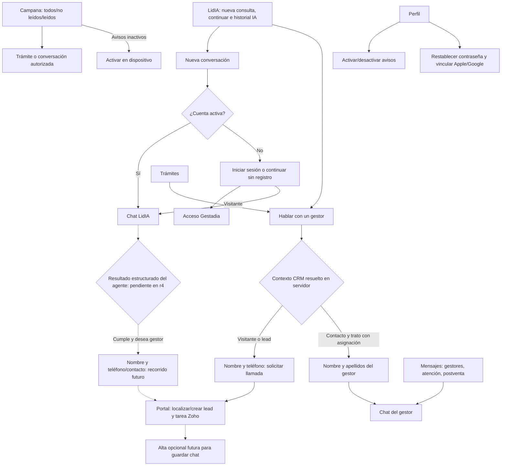

Las líneas discontinuas describen una decisión de producto cuya operación remota todavía no existe en r4. La llamada explícita funciona por su adaptador separado: no convierte una respuesta de texto en elegibilidad ni afirma que se haya creado una cita. Una cuenta Gestadia existente sí puede vincular un chat visitante si controla la instalación original; ofrecer un alta nueva tras contacto sigue siendo un paso futuro.

## Pantallas observadas

[Mapa visual navegable con las capturas](evidencias/2026-10-11-recorridos/index.html) · [Manifiesto de evidencia y cómo abrirlo](evidencias/2026-10-11-recorridos/README.md).

Son capturas de la interfaz real de esta revisión contra un servidor local con respuestas ficticias. No son ejecución del agente 119 ni entregas a Zoho. La captura iOS acredita arranque de los mismos assets con configuración privada de prueba.

| Entrada sin registro | Consulta visitante | Volver y continuar |
|---|---|---|
| 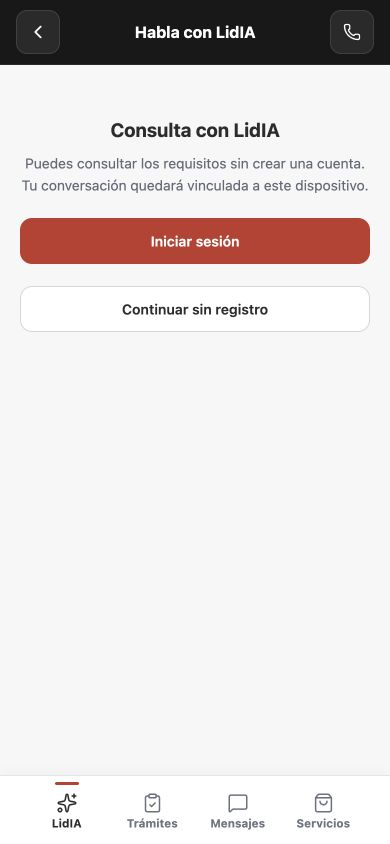 | 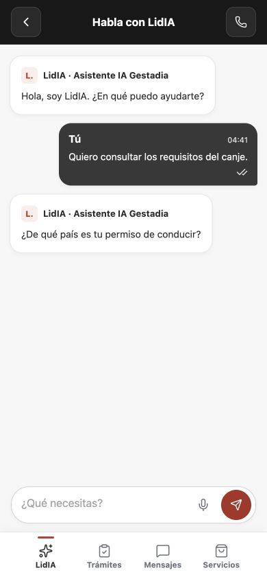 | 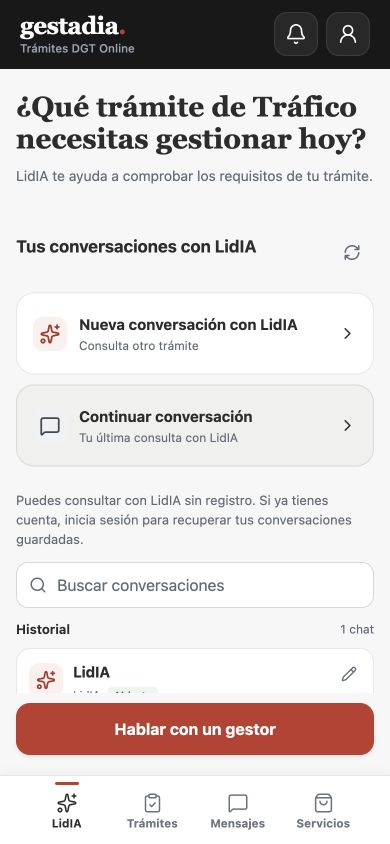 |

| Mensajes: sólo gestores | Renombrar con Cancelar | Gestor asignado | Chat humano |
|---|---|---|---|
| 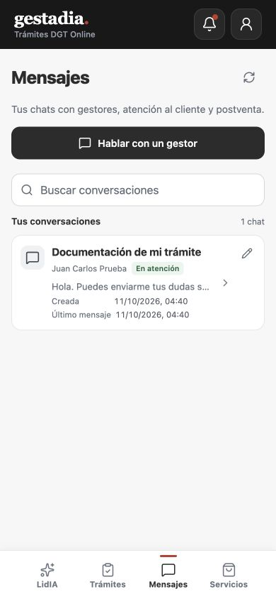 | 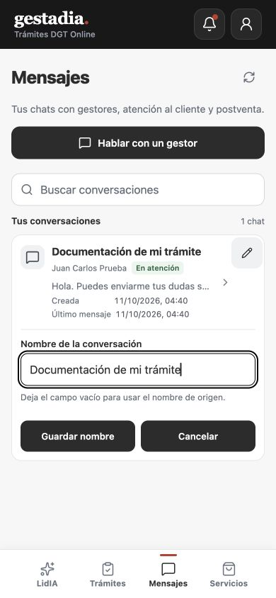 | 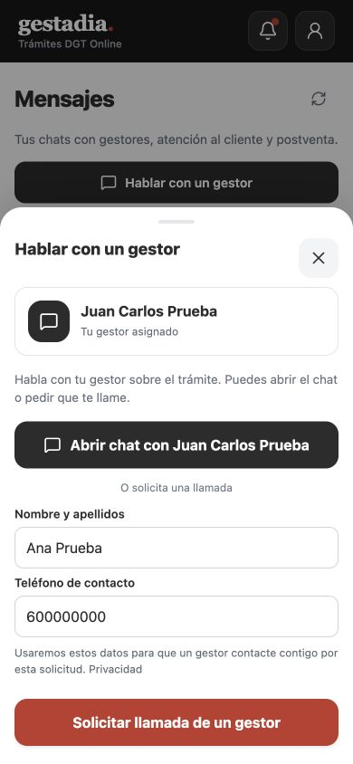 | 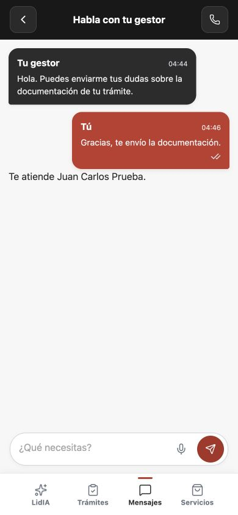 |

| Llamada voluntaria visitante | Avisos no leídos | Perfil y seguridad |
|---|---|---|
| 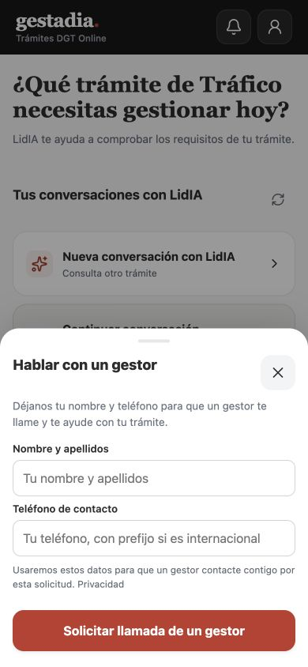 | 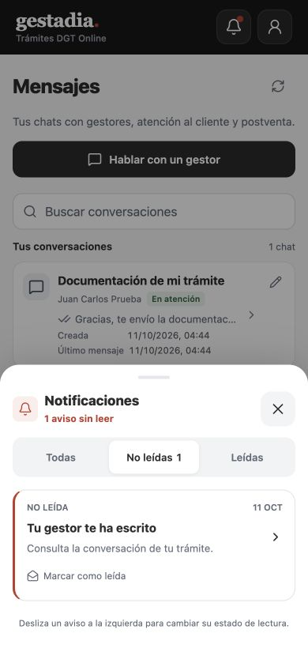 | 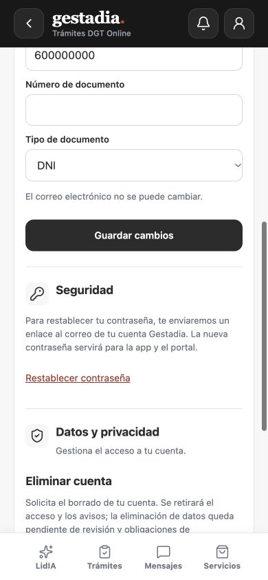 |

## Comprobación y límites

- **285 pruebas backend y 191 frontend** pasan con `node scripts/test-app-conversations.mjs`, MySQL temporal aislado, migraciones completas y build APP. Incluye recuperación del mismo intento, exclusión entre propietarios, vínculo de instalación/cuenta, recibos, acceso social por email verificado, revocación de avisos, pertenencia de notificaciones y asociaciones de tareas Zoho.
- Revisión web a **390 × 844**: entrada anónima sin campos de contacto, texto literal, regreso/continuación del mismo chat, llamada voluntaria, separación de historiales, Cancelar, gestor identificado, burbuja roja, filtro y apertura de conversación desde un aviso, perfil y ausencia de desbordamiento horizontal. El servidor de evidencia es ficticio y se identifica como tal en su README.
- `mobile:sync` y build iOS Debug de simulador completados. Instalado y observado el arranque en **iPhone 17 / iOS 26.5**. Device Hub muestra **Capture Keyboard = on**; la automatización de pulsación falla con `noWindowsAvailable`. No se acredita escritura, ciclo completo nativo, iPhone físico, Android, push APNs/FCM ni publicación de esta revisión.
- OAuth de Apple/Google necesita sus credenciales y retornos efectivos; las pruebas de contrato no prueban login real de proveedores. Email verificado existente permite acceder directamente; email desconocido explica la cuenta Gestadia/servicios, sin crear un usuario social.
- No se han ejecutado migraciones ni activado guest en PRO, ni cambiado el grant de la cuenta de prueba para forzar un gestor. El registro conectado v1 anterior conserva su propio entorno y evidencia.

## Contrato y coordinación

Wire **r4** recibido de LidIA: [contrato](../integraciones/2026-10-11-app-v2-wire-lidia-r4.md), [schema cerrado](../integraciones/fixtures/app-v2-responses.schema.json), [muestras](../integraciones/fixtures/app-v2-service-samples.json). Copias byte a byte de la entrega `a57813450c9f40f1eb075afb6d4b7b99ae9c135e` de Gestadia_LidIA; no se reescriben las actas antiguas.

LidIA corrigió la sesión `atencion` para iniciar sin saludo/prospección IA, con IA deshabilitada y posterior handoff sobre la misma ChatSession: [PR 1627](https://github.com/enmarkados/Gestadia_LidIA/pull/1627), commit `c3a0b398f5bf092d857ee34ef9bba1a5eb019a43`, merge `a1777aec66a8189ac5ab54ec704c301356b7f15e`, marcador **V1.720-app-atencion-sin-sondeo**. Sus **174 pruebas** son TestServer/SQLite; la versión PRO comunicada sigue V1.718. Ese merge no demuestra despliegue ni atención real.

Para cerrar la prueba conectada conjunta hacen falta: integración/keys v2 de DEV con vigencia explícita; cuenta, contacto y trato propios; expediente autorizado; mapping privado entre la asignación LidIA y Owner Zoho; grants **history + manager_handoff + case_context**; versión remota que incorpore la corrección de atención; credenciales CRM y destinos OAuth/push efectivos. No se permiten selectores de agente, operador o CRM enviados por el dispositivo.

El [procedimiento DEV de LidIA](../integraciones/2026-10-11-procedimiento-dev-lidia.md) se recibió del commit documental `2446be441675d538d06bfbedb83f87c3ebe2fb19` / PR1628. Se conserva exacto y su procedencia está en el índice. Incluye los casos conjuntos de texto real, recuperación, vínculo, atención sin IA y revocación, más comprobación previa del aislamiento y cierre explícito de claves. Sigue sin ejecutar; no convierte esta evidencia local en aceptación remota.

## Configuración y recuperación

Consultar la [guía técnica de configuración y pendientes](2026-10-11-configuracion-recorridos.md). No guardar secretos en esta documentación ni utilizar el servidor ficticio para aceptación remota.
