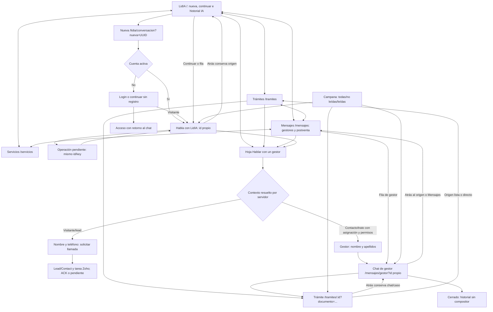
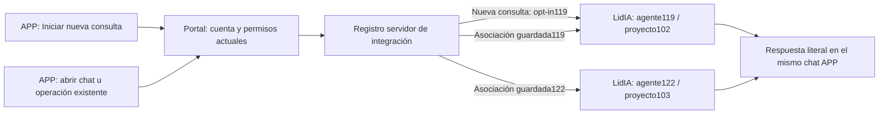
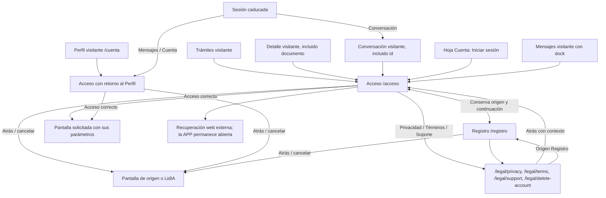
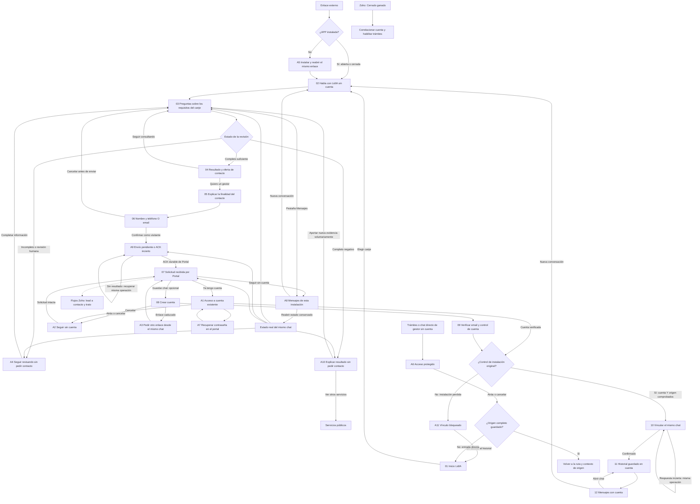
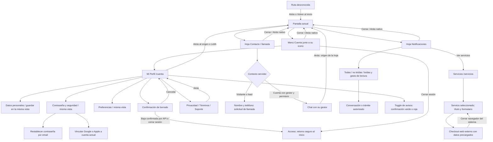
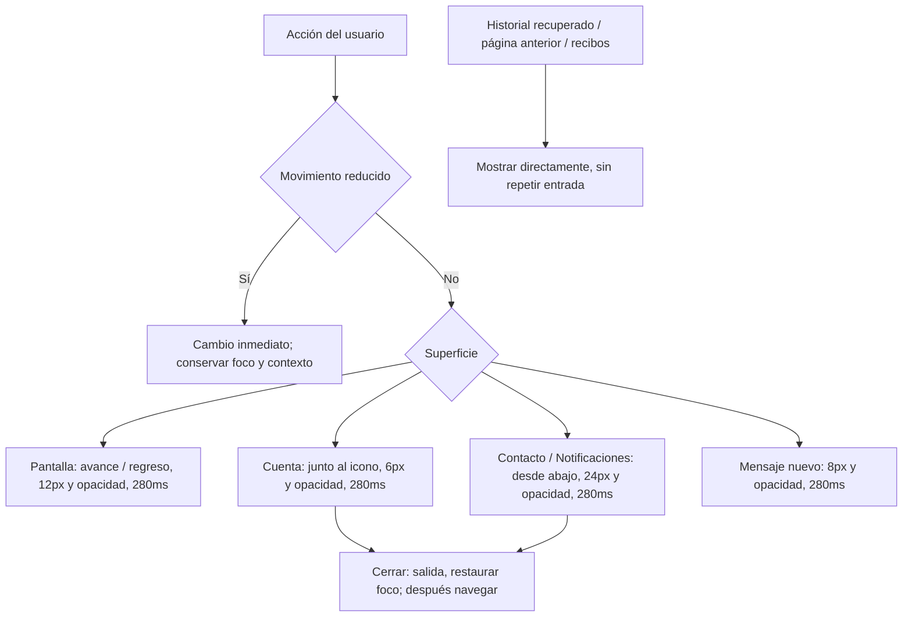

# Navegación de Gestadia APP

[Manual de desarrollo: cómo consultar y mantener este mapa](MANUAL-DESARROLLO.md).

**Mapa vigente · revisión del 11/10/2026:** [plan y pantallas capturadas](2026-10-11-recorridos-gestores.md). Implementación autorizada por respuesta humana: LidIA recoge IA y su historial; Mensajes recoge gestores/atención/postventa. Guest v2 por instalación está integrado y apagado por defecto. El resultado cualificado/contacto automático y el alta opcional conservan sus dependencias pendientes. Los mapas de propuesta del 10/10 se mantienen como antecedentes.

La precisión humana posterior fija que preguntas y decisiones pertenecen al agente 119. Los estados del diagrama representan lo que la APP muestra del agente; el cuestionario ilustrativo de la maqueta no define un motor de canje en Portal. Texto como respuesta base; contenido dinámico opcional. [Criterios vigentes del manual](MANUAL-DESARROLLO.md#criterios-que-debe-conservar-el-desarrollo).

Auditoría del 07/10/2026. Alcance: rutas reales de `frontend/app/src/App.jsx`, modos visitante/demo/conectado, hojas y vistas de cuenta. Este mapa no valida permisos ni configuración de producción. [Glosario](../../GLOSARIO.md).
Mapa vivo actualizado el 10/10/2026 tras retirar la demostración. Alcance: rutas reales de `frontend/app/src/App.jsx`, visitante o sesión conectada, hojas y vistas de cuenta. La sección de comprobación del 07/10 conserva evidencia histórica. Este mapa no valida permisos ni conversación en producción. [Glosario](../../GLOSARIO.md).

Regla: las cuatro pestañas son destinos principales y conservan el menú inferior. Una pantalla secundaria tiene Atrás al origen interno completo, o a su destino de reserva si se abre directamente. Acceso/registro y documentos legales pueden ocultar el menú, pero siempre permiten volver. Entrar no pierde la pantalla solicitada. Las hojas cierran sobre la pantalla que las abrió; navegar desde ellas guarda esa pantalla como origen, sin reabrir la hoja al volver.

La revisión publicada sin demostración es `be6806d`, comprobada de nuevo el 10/10 a las 21:05 UTC. [Registro público observado](evidencias/2026-10-10-sin-demo/registro-web.png) · [Estado Docker y límites pendientes](ESTADO-APP-PORTAL-DOCKER.md). Chat, login social y push nativos requieren su aceptación real por separado.

## Pestañas, conversaciones y trámites

LidIA distingue Nueva/Continuar e historial. Mensajes ya no ofrece ni lista IA. Dentro de un chat LidIA no se inicia otro: Atrás lleva a su origen. `nueva=UUID` conserva el intento; con cuenta se confirma Iniciar y como visitante la elección Continuar sin registro inicia el mismo intento. Una creación incierta conserva key y operación. La conversación guest se identifica también con `invitado=1`, mantiene id y actor histórico; cuenta comprobada y control de instalación son necesarios para vincular.

El chat conectado se identifica por `conversacion` y, cuando procede, `caso`. Esos parámetros forman parte del retorno; no se sustituye el chat seleccionado por uno nuevo. La validación real admite carga de documentos con FormData y sólo confirma el resultado devuelto por la API. Un error de carga permanece en la misma pantalla y conserva Atrás.

### Asociación backend preparada el 11/10/2026

Las pantallas, los parámetros y sus destinos de Atrás permanecen iguales. El servidor conserva la asociación de cada chat y reevaluará el destino de una consulta implícita si confirma que el candidato está cerrado. Nueva consulta119 exige configuración privada y autoridad vigente; atención e historial122 conservan su asociación. La APP no recibe un selector de agente. [Estado, pruebas y recuperación](2026-10-11-reanudacion-app-119.md).

Este diagrama explica la resolución integrada. La instancia local5177 quedó configurada para119 con una cuenta ficticia nueva autorizada durante24h; login, nueva consulta, un turno y recuperación fueron observados en UI; la evidencia SQL fuente de la misma sesión119 acredita una llamada real al modelo. La aceptación nativa, el sondeo completo y otros recorridos se registran por separado. No añade pantallas ni habilita visitantes v2. [Instancia y evidencia](2026-10-11-reanudacion-app-119.md#instancia-conectada-preparada--11102026).

## Acceso, registro y sesión

El registro conectado explica el acceso compartido Portal/APP; no crea otra cuenta. Recuperación abre el navegador del sistema en nativo, o una pestaña separada en web. Ni cancelar ni Atrás efectúan logout o crean una conversación.

### LidIA sin cuenta: mapas actualizados el 10/10 (propuesta)

**Antecedente de diseño del 10/10.** La consulta guest y vínculo están implementados en la revisión del 11/10; contacto automático cualificado/alta/agenda permanecen propuestos. El historial IA vive ahora en LidIA, aunque las capturas originales llamen Mensajes al destino. Esta propuesta conserva la decisión humana: **primero requisitos; contacto sólo tras resultado suficiente y voluntad de gestor; solicitud como visitante; cuenta opcional después para guardar el chat**. [Diagrama con capturas](2026-10-10-mapas-pantallas-app-anonima.md) · [Propuesta técnica](../integraciones/2026-10-10-propuesta-app-anonima-lidia.md) · [Contraste con LidIA](../integraciones/2026-10-10-contraste-portal-app-anonima.md).

Un deeplink abre el chat sin pasar por Inicio o acceso. APP cerrada/abierta resuelve una sola entrada. Sin APP instalada se indica instalar y **reabrir el mismo enlace**; no se presume que la tienda conserve el contexto.

| Pantalla / estado propuesto | Orígenes | Atrás / cancelar; reserva directa | Menú inferior | Al completar |
|---|---|---|---|---|
| 01 Inicio LidIA | Primera apertura / pestañas | Principal | Sí | Abrir canje o continuar chat propio |
| 02 Consulta / 03 Preguntas | Deeplink / Inicio / Mensajes | Origen; LidIA si directo | Sí | Misma sesión; sin pedir nombre ni contacto |
| 04 Resultado suficiente | Revisión completa del agente | Origen; conserva chat | Sí | Ofrecer gestor; no activar por país o human_review |
| 05 Contacto / 06 Datos | Resultado suficiente y voluntad expresa | Chat; cancelar antes del envío | Sí | Nombre y teléfono O email, propósito y confirmación como visitante |
| 07 Solicitud recibida | ACK durable de Portal | Chat / Mensajes | Sí | Cuenta opcional; solicitud no equivale a cita |
| 08 Registro / A1 Acceso | Oferta de guardar chat tras la solicitud | Mismo chat; solicitud intacta | No; Atrás visible | Verificar cuenta y control de instalación original |
| 09 Verificación de email | Registro opcional | Corregir email / registro | No; Atrás visible | No envía otra solicitud |
| 10 Vinculación pendiente | Cuenta verificada Y control de instalación original | Recuperar misma operación; conservar contexto | No; retorno visible | Misma sesión, actor histórico y solicitud |
| 11 Chat vinculado | Retorno del alta / Mensajes | Origen; LidIA si directo | Sí | Mismo historial recuperable en otros dispositivos |
| 12 Mensajes con cuenta / A8 visitante | Pestaña | Principal | Sí | Filas compactas; Nueva conversación aquí, sin botón flotante en chat |
| A2 Cancelación / A3 caducidad | Alta opcional | Chat original | Atrás visible | No cancela ni reenvía la solicitud recibida |
| A4 Revisión incompleta | Resultado parcial/revisión humana | Origen; conserva respuestas | Sí | Seguir sin pedir contacto comercial |
| A9 Solicitud pendiente | Datos confirmados, envío/ACK incierto | Origen; operación conservada | Sí | Comprobar la misma operación; «recibida» sólo tras ACK durable |
| A10 Resultado negativo | Resultado completo del agente | Origen / Servicios; nueva evidencia voluntaria | Sí | No repetir automáticamente ni abrir gate de contacto |
| A11 Vínculo bloqueado | Cuenta verificada sin control de instalación original | Inicio; no historial ajeno | No; Atrás visible | Recuperación separada por acordar; enlace/contacto no bastan |
| A7 Recuperación de contraseña | Acceso opcional | Acceso con continuación | Atrás visible | Recuperación externa sin perder chat |
| A6 Trámites / gestor directo | Pestaña / deeplink protegido | Acceso con retorno al origen | Según ruta | La solicitud de contacto no concede chat de gestor ni expedientes |
| Legales / soporte | Chat / acceso / registro / cuenta | Pantalla exacta que abrió el documento | No; Atrás visible | Volver sin consumir la continuación |

Las preguntas son estados del mismo chat. Atrás en su cabecera vuelve al origen; reabrir la fila recupera el estado alcanzado. Antes del envío se puede cancelar la intención; **cancelar el registro después no cancela la solicitud ya recibida**. La sesión identifica el recorrido y su pertenencia, sin acreditar una cuenta por coincidencia de teléfono/email.

La cuenta gratuita no habilita expedientes. Los flujos Zoho convierten lead a contacto/trato y envían Cerrado ganado al backend Gestadia. El tablero es una maqueta declarada, no una ejecución de LidIA, registro real, agenda o iOS/Android.

## Cuenta, hojas y servicios

En web el checkout abre una pestaña separada; en nativo abre el navegador del sistema, conservando la pantalla y el formulario en la APP. Los bloques de perfil y cambios de servicio son estados de su pantalla, no páginas nuevas. El borrado de cuenta y los permisos mantienen sus restricciones actuales. La cuenta procede de contratación/eventos Zoho; la APP no elige un operador ni concede permisos por cambiar de ruta.

## Inventario y decisión de retorno

| Pantalla / estado | Orígenes | Atrás; reserva para entrada directa | Menú inferior | Al completar |
|---|---|---|---|---|
| `/` LidIA | Pestañas / marca | Principal | Sí | Nueva, continuar e historial IA propios |
| `/tramites` | Pestañas | Principal | Sí | Visitante abre acceso y retoma Trámites |
| `/mensajes` | Pestañas / chat | Principal | Sí, también visitante | Sólo gestores/atención/postventa; entrar o solicitar llamada |
| `/servicios` | Pestañas / notificaciones | Principal | Sí | Selección desplaza al título; checkout externo |
| `/lidia/conversacion?nueva=UUID` | LidIA / acceso | Origen; `/` | Sí | Cuenta: Iniciar; visitante: elegir Login o continuar sin registro |
| `/lidia/conversacion?conversacion=ID` | LidIA / notificación / enlace | Origen; `/` | Sí | Misma sesión; `invitado=1` identifica consumidor guest/vinculado |
| `/mensajes/gestor` | Mensajes / Contacto / trámite | Origen; `/mensajes` | Sí | Id humano propio; cerrado conserva historial; directo sin id abre contexto gestor |
| `/tramites/:id` | Lista / notificación / documento del chat | Origen con query; `/tramites` | Sí | Carga documental por API; conserva el origen |
| `/cuenta` | Menú Cuenta / enlace directo | Origen; `/` | Sí autenticado; no visitante | Datos, restablecimiento, vínculos sociales y toggle push |
| `/acceso` | Trámites / chat / Cuenta / entrada directa | Origen; `/` | No | Pantalla solicitada y contexto; por defecto `/` |
| `/registro` | Acceso / entrada directa | Mismo origen del acceso; `/` | No | Informa sobre la cuenta compartida y la invitación; invita al acceso |
| `/legal/privacy` | Cuenta / Acceso / Registro | Origen completo; `/acceso` | No | Atrás restituye contexto |
| `/legal/terms` | Cuenta / Acceso / Registro | Origen completo; `/acceso` | No | Atrás restituye contexto |
| `/legal/delete-account` | Cuenta / navegación legal / directo | Origen completo; `/acceso` | No | Explica la baja real y la conservación justificada de expedientes |
| `/legal/support` | Cuenta / Acceso / Registro | Origen completo; `/acceso` | No | Enlaces externos sin perder la APP |
| Cuenta: datos, seguridad, preferencias | Dentro de Perfil | Cabecera del Perfil; bloques sin navegación | Como Perfil | Permanecer en vista |
| Borrado / renombrado / hojas | Perfil / Mensajes / cabecera / llamada | Cancelar o cerrar primero; devuelve foco al control de apertura | Pantalla de fondo | No usar historial hasta cerrar |
| Error / carga / sin permisos / chat cerrado | Ruta vigente | Conserva retorno de la ruta | Según ruta | Reintento no cambia origen |
| Ruta inexistente | Enlace / entrada directa | Origen válido; `/` | Sí | Volver al inicio |

## Hallazgos y comprobación históricos del 07/10

Antes del cambio: se reprodujo en navegador Trámites visitante → Entrar al portal → `/cuenta`, sin menú ni Atrás; acceso enviaba siempre a LidIA. El análisis de rutas confirmó retorno fijo del expediente al gestor y del chat IA al inicio, y pérdida del formulario al regresar del checkout demo.

Verificación de la corrección:

- **85 pruebas APP aprobadas en 11 archivos**, con `NODE_OPTIONS=--no-experimental-webstorage npx vitest run app/src`. Incluye 12 regresiones de navegación: cancelar/acceder desde Trámites, registro/legal/retorno, expediente y documento, chat exacto y caso, Perfil desde Servicios, LidIA desde Mensajes, checkout demo y borrador, acceso en Mensajes y entradas directas. Dos pruebas nativas acreditan la prioridad de la acción visible de retorno y la apertura externa web.
- **Navegador servido:** se reprodujo y comprobó Trámites → acceso → Atrás en `127.0.0.1:5175`; en `127.0.0.1:5176` se recorrió Trámites → acceso → registro → privacidad → términos → registro → acceso correcto → Trámites con la cuenta ficticia autorizada. También Servicios → hoja Cuenta → Perfil → Atrás → Servicios, y Mensajes → LidIA → Atrás → Mensajes. No se envió otro mensaje ni se abrió un chat remoto nuevo.
- **iOS real en simulador:** `com.gestadia.app`, Debug, iPhone 17 / iOS 26.5, build y arranque correctos. Trámites visitante → acceso → Atrás recupera Trámites y las cuatro pestañas. Trámites → Mensajes visitante → Atrás también recupera Trámites. La cabecera respeta la zona superior segura y los controles están visibles.
- **Android:** `assembleDebug` correcto (213 tareas), APK actualizado en `emulator-5560` mediante instalación con conservación de datos (`Success`); no se afirma ejecución del recorrido de interfaz. La aceptación global Android sigue pendiente de la autorización específica solicitada para el control del emulador. Sus pruebas unitarias no sustituyen esa ejecución.

[Acceso web con retorno a Trámites](evidencias/2026-10-07-navegacion/web-acceso-tramites.jpg) · [Atrás en acceso iOS](evidencias/2026-10-07-navegacion/ios-acceso-con-atras.jpg) · [Trámites y menú recuperados en iOS](evidencias/2026-10-07-navegacion/ios-retorno-tramites.jpg).

El checkout externo se verifica mediante prueba del destino y de la apertura separada, sin contratar ni pagar. El expediente desde notificaciones y la apertura del chat recién creado conservan el contexto por código; no se añade una afirmación de ejecución remota de esos recorridos. Las configuraciones públicas de compilación nativa siguen apuntando sólo al entorno local ya aprobado; la configuración versionada por defecto no se activa para producción.

### Presentación de Mensajes

Los listados utilizan filas compactas, búsqueda, fechas, estado, recibos y renombrado en la fila con Guardar/Cancelar. LidIA filtra sondeo v1 y guest v2 propios; Mensajes filtra atención/gestor/postventa. El acceso Hablar con un gestor abre el contexto actual y nunca convierte una consulta IA por URL. La apertura de gestor requiere ACK de handoff; un error permanece en la hoja con el borrador. Atrás conserva el origen completo.

### Revisión común de pantallas histórica

El [plan de diseño y matriz visual](PLAN-DISENO-APP.md) actualiza la suite conjunta a **88 pruebas APP aprobadas** y registra 64 inspecciones en cuatro anchuras, además de los retornos recorridos en el simulador iOS. Información y checkout demo mantienen Atrás y dock sin CTA de contacto duplicado. Mi Perfil conectado remite la recuperación al portal y no solicita contraseñas para una operación todavía pendiente. El recorrido de interfaz del APK Android de esta revisión sigue pendiente.

### Comprobación autenticada en APP — 11/10/2026

Sesión real de la cuenta de pruebas: Inicio → Nueva conversación → Iniciar → consulta → respuesta de LidIA → opción No → segunda respuesta → Mensajes → mismo historial recuperado. Dos turnos y dos respuestas observadas; opciones consumidas y retorno Volver a Mensajes. No se solicita atención, contratación ni expediente. [Captura nueva del historial](evidencias/2026-10-11-chat-real/chat-recuperado.png). Esta prueba acredita el recorrido web autenticado; OAuth y entrega push nativos conservan su aceptación independiente. Las maquetas anónimas no se activan.

### Arranque nativo comprobado — 11/10/2026

La entrada esperada por SecureStorageNative contenía una espera de nivel superior que bloqueaba su importación circular. El arranque se ejecuta ahora desde startApp después de terminar la evaluación del módulo; mantiene el orden configuración, sesión segura, teclado y retorno social. Si la preparación falla se muestra la recuperación existente (Recargar) y se retira el splash. Dos regresiones reproducen primero el bloqueo y el rechazo sin recuperación, y pasan tras el cambio. Suite frontend 162/162. Android debug abre Home real con 4 GB/cuatro núcleos; captura [home-debug.png](evidencias/2026-10-11-arranque-android/home-debug.png). Aún sin atribuir firma de distribución, login o push a esa captura.

La misma corrección de arranque supera también la instalación y apertura del APK Release firmado, con hash instalado idéntico. [Home Release Android](evidencias/2026-10-11-arranque-android/home-release.png). Acceso preparado para el usuario; OAuth y push todavía pendientes.

### Identidad visual del acceso social — 11/10/2026

Petición humana: botones oficiales Apple/Google en Android e iOS. Acceso `/acceso` y vinculación en Mi Perfil conservan origen, permisos y acciones existentes. Se reemplaza la presentación genérica por la imagen española generada por Apple y el símbolo degradado del paquete vigente de Google, con Google Sans Medium. Ambos controles tienen 48 px CSS de altura y el mismo ancho; Google usa márgenes 12/10 px en Android y 16/12 px en iOS. Los recursos son locales y no requieren cargar un SDK remoto para dibujar el botón. La vinculación se explica antes del botón «Continuar con», preservando el propósito `link`. Compilación y aceptación visual nativa se registran por separado en el estado Docker.

Aviso Android real recibido en segundo plano: pulsarlo abre Mi Perfil para la sesión propietaria; la campana indica avisos pendientes. No se publica el contenido del trámite en la notificación del sistema. Se crea el canal gestadia_updates antes de registrar Android, incluyendo la reapertura de una instalación ya activada. iOS conserva su registro APNs independiente.

Segunda recepción real Android 82d011a en canal propio gestadia_updates comprobada; mantiene marca oficial y sesión real. [Capturas nuevas y límites de aceptación](evidencias/2026-10-11-marketplaces/README.md). iOS 0.1.0 (1) subido y procesado en TestFlight; no acredita OAuth, APNs ni instalación.

### Movimiento y continuidad · 11/10/2026

Las rutas, permisos y destinos de Atrás de las tablas anteriores se conservan. El contenido de la pantalla entra en 280 ms con opacidad y 12 px de desplazamiento: avance desde la derecha, regreso desde la izquierda. Sólo los cambios de ruta se animan; query/id dentro de una misma pantalla no la remontan. La cabecera y el dock quedan fuera del movimiento.

Cuenta se abre junto al control de cabecera; las otras hojas siguen en la parte inferior. Escape/X/fondo cierran con salida antes de devolver el foco. Las acciones de Cuenta y Contacto esperan esa salida antes de navegar; enlaces de Notificaciones conservan su navegación normal y cancelan la superficie al cambiar de ruta. Si cambia la preferencia a movimiento reducido durante el cierre, se completa inmediatamente. El detalle de implementación, pruebas y capturas nuevas está en [ANIMACIONES.md](ANIMACIONES.md); las evidencias nativas anteriores no acreditan este movimiento nuevo.

### Actualización nativa solicitada · 11/10/2026

Integración de movimiento d3ca03c en la rama marketplace conservando el flujo real sin demos. El usuario aprueba escritura LidIA y pide sincronizar compositor/menú con el teclado iOS. No cambia pantalla, origen, permisos, destino de Atrás ni acción final. [Detalle de implementación y límites](ANIMACIONES.md#candidato-nativo-con-escritura-y-teclado--11102026). Nueva build TestFlight (2) en preparación; no atribuir estas mejoras a la build instalada (1).

### Escritura de LidIA animada · 11/10/2026

El usuario usa build (2) y solicita animar también el texto. El indicador conserva cursiva, ubicación, permisos y retirada al responder/fallar; texto con pulso suave 1600 ms y puntos secuenciales 1200 ms (0/160/320 ms, 3 px). No cambia origen, navegación, Atrás ni acción final. Movimiento reducido mantiene los cuatro elementos estáticos y legibles. [Verificación del indicador y límites de build (3)](evidencias/2026-10-11-escritura-animada/README.md).

### Escritura en negrita y puntos en ola · revisión del 11/10/2026

La petición humana sustituye la cursiva por negrita y añade entrada/salida suaves 280 ms, pulso de texto 1800 ms y ola visible de tres puntos 1400 ms con desfases0/200/400ms y subida 5 px. LidiaTypingIndicator conserva el DOM durante la salida y retira el anuncio accesible al responder; movimiento reducido permanece estático con retirada inmediata. Pantalla, origen, permisos, destino de Atrás y acción final se conservan. [Evidencia local y estado de distribución build (5)](evidencias/2026-10-11-escritura-ola/README.md).

### Burbujas nuevas de LidIA · revisión del 11/10/2026

Corrección solicitada para `/lidia/conversacion`: entrada suave 280 ms/8 px desde el primer fotograma, conservación de la referencia del historial al recibir páginas nuevas y desplazamiento suave al llegar respuestas. Los segmentos históricos `[SPLIT]` de LidIA se presentan como burbujas separadas; los segmentos nuevos de un mismo mensaje entran con desfases de 80 ms (máximo320ms). Identidad, recibos y acciones se conservan; la presentación interactiva aparece una sola vez, en el último segmento. No cambia origen, permisos, destino de Atrás ni acción final; no confirma ni crea reservas. Carga inicial/páginas antiguas y movimiento reducido permanecen directos. [Evidencia de esta revisión y estado build (6)](evidencias/2026-10-11-burbujas-suaves/README.md).

La recarga directa de `/lidia/conversacion` y `/lidia/conversacion/` se sirve también mediante el índice APP de Docker; el bloqueo del proxy antiguo bajo `/lidia/` se mantiene para sus endpoints. No se cambia la navegación ni la autorización de la pantalla. [Regresión HTTP y evidencia](evidencias/2026-10-11-burbujas-suaves/README.md).

### Hora al pie de las burbujas · 11/10/2026

Corrección solicitada para `/lidia/conversacion` (cuenta o visitante habilitado) y las conversaciones de gestor: la hora procedente de `occurred_at` se muestra al final, alineada a la derecha. En mensajes propios queda inmediatamente a la izquierda de los ticks de entrega confirmados por el servidor; en LidIA y gestor se muestra sin ticks. Si existe una presentación con botones, el pie queda después de ella. Conserva origen, Atrás, permisos, envío y entrada animada; no modifica mensajes persistidos. [Evidencia de esta revisión](evidencias/2026-10-11-hora-pie/README.md).

### Desplazamiento al tocar el compositor — 11/10/2026

Tocar o enfocar el campo de las conversaciones lleva suavemente al último mensaje en 280 ms; otro toque también funciona si el campo ya está enfocado. Mientras tiene foco, adapta el destino al cambio de altura del teclado. Al salir del campo se puede leer el historial libremente. Reducir movimiento lleva directamente al fondo. Pantalla, origen, permisos, destino de Atrás y envío se conservan; no envía mensajes ni ejecuta reservas. [Evidencia y distribución de esta revisión](evidencias/2026-10-11-scroll-compositor/README.md).

### Contacto visible y carga de chats — 11/10/2026

La hoja «Hablar con un gestor» acompaña el teclado y permite desplazar su formulario para mantener visible el teléfono. La carga de conversaciones/mensajes y comprobación del gestor incorpora GIF propio centrado y texto contextual; movimiento reducido usa imagen fija. Actualizar conserva el historial y los errores retiran el indicador. No cambia origen, Atrás, permisos, asignación ni envío. El proxy Docker común admite las tres rutas exactas de contacto que faltaban en la plantilla seleccionada. [Verificación y límites](evidencias/2026-10-11-gestor-carga/README.md).

### Conversación antigua de atención — revisión 11/10/2026

La cuenta de prueba conserva un chat de atención sin gestor ni caso, con permiso exclusivo `history`. El servicio rechaza un turno técnico con `capability_denied`. La pantalla mantiene el historial, desactiva acciones y compositor, explica la restricción y remite a «Solicitar llamada». Origen Mensajes; Atrás devuelve a Mensajes. No se crea una conversación alternativa ni se modifica la asignación. [Evidencia y límites](evidencias/2026-10-11-gestor-carga/README.md).

### Aceptación web LidIA V1.722 — 11/10/2026

Inicio → Nueva conversación → Iniciar → dos turnos informativos seriados → recargar mantiene historial. Origen/Atrás LidIA, permisos history/sondeo, ninguna acción de llamada/alta. Detalle común administrativo APP abierto con Contacto pendiente. [Capturas, IDs y límites](evidencias/2026-10-11-lidia-v1722/README.md). Sin cambio visual o nativo; gestor, CRM y agenda conservan aceptación separada.
