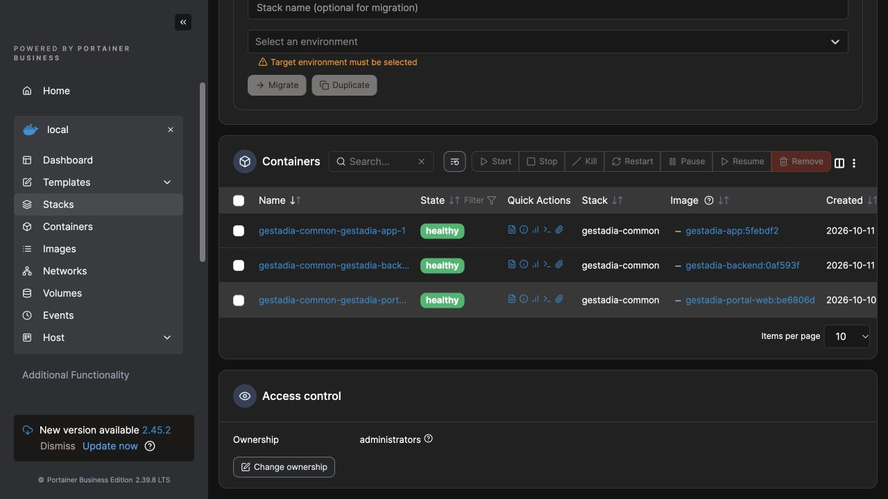

# Backend de agenda desplegado — 11/10/2026

Continuación de la preparación del [recibo](../2026-10-11-recibo-agenda/README.md), [perfil](../2026-10-11-perfil-contexto/README.md) y [permiso por conversación](../2026-10-11-agenda-opt-in/README.md). Estos documentos previos conservan su alcance histórico.

Se creó una copia nueva `agenda-connected-20261011` de SQL, configuración privada, claves y documentos antes de migrar y sustituir el backend. SQL: 278460 bytes, SHA256 `aa258fc7c484734176277d9ddf0b331bedae10288da03d3cefa19fc52a508c4b`. Restauración real en MariaDB aislada sin red: 45 usuarios, 94 expedientes, 14 documentos, 13 migraciones previas y 24 tablas correctas. Configuración y documentos restaurados iguales byte a byte. No se elimina ningún registro.

Portainer aplica las migraciones `20261011192000_app_callback_scope` y `20261011210000_app_profile_context` con salida 0; total 15. Imagen backend `0af593f`, AMD64, generada sobre la imagen base vigente con dependencias sin cambios y Prisma regenerado; 81 archivos fuente/contratos/esquema coinciden por SHA256. Imagen exportada: SHA256 `99acec3c7a8e212bd7209ccc16cb110efc1345ee9a9859ad29214acdb516a13b`. Config ID Docker importado `b8613609018f45f25724b16bbd7970cbb20960af2845b83698c243f1121a8c66`.

Stack 73 ejecuta el nuevo contenedor backend `93ba9786b5837f5c2914d668adc077ce200e4dbd998fd2c3c2753fce151589d4`, creado a las 20:59 hora del servidor. Tres servicios saludables; APP `5febdf2`, web/Portal `be6806d`, configuración y almacén documental persistentes conservados. La primera actualización conservó la imagen anterior: no se consideró despliegue del consumidor. Se corrigió el editor de Portainer y se verificó el nuevo contenedor después de guardar.

Lectura dentro del contenedor activo: esquema v1 SHA256 `4151ef56af4c24033792d0cb7327bd5e092260a5d933d500014f82bd6536897f`, cuenta y conversación previstas vinculadas, `callbackGrant` nulo, perfil opcional apagado, `profileBaseline` nulo y revisión 0. Permiso adicional de agenda apagado. Los recuentos 45/94/14 permanecen iguales. La APP autenticada recupera el historial informativo de la misma conversación sin enviar otro turno.

La agenda sigue pendiente: V1.723 de LidIA aún no acreditada como servida en este momento, confirmación humana del alcance CRM por una hora y datos operativos de llamada pendientes. Este despliegue no acredita llamada creada, lectura de Zoho ni una nueva build nativa. El usuario acepta físicamente el editor de nombre de TestFlight (11) en un [acta separada](../2026-10-11-editor-nombre/aceptacion-iphone.json).
