# Agenda real — 12/10/2026

Continuación del [backend desplegado](../2026-10-11-agenda-despliegue/README.md). El usuario confirma literalmente «Sí, solo esta cuenta y conversación durante una hora» para la cuenta de sistemas, la conversación acordada, Portal/LidIA y Zoho Production EU conexión 4. Aporta contacto real y solicita el 13/10/2026 a las 10:00 de Madrid (08:00 UTC). Los datos privados se conservan fuera de Git; no se inventan requisitos de canje ni se reutiliza el escenario ficticio de Playground.

Antes de activar se crea la copia nueva `agenda-activation-20261012`: SQL de 279625 bytes, SHA256 `c83d1cb8e89a4e43d32b4210a52c1b1dc02b792c77f453d01f2e9b4eceda651d`; 45 usuarios, 94 expedientes, 14 documentos y 15 migraciones. Configuración SHA256 `348029ec6790f5f86d9ed04634a6e297e6ba7dbc35e91012248aaf317ac4e3fe`, uploads SHA256 `7d612eb838808d8ddbff599062faeeb5de0c331a6311a9e61fe545a57d8d5d53`. Stack 104: tres procesos terminados con código 0.

Restauración real aislada y sin red en stack 105: mismos recuentos, 24 tablas correctas, salida 0. Configuración, claves y documentos restaurados coinciden byte a byte, salida 0. Se conserva el stack común vigente y su configuración de rollback. La APP recargada mantiene la autenticación y el mismo historial informativo.

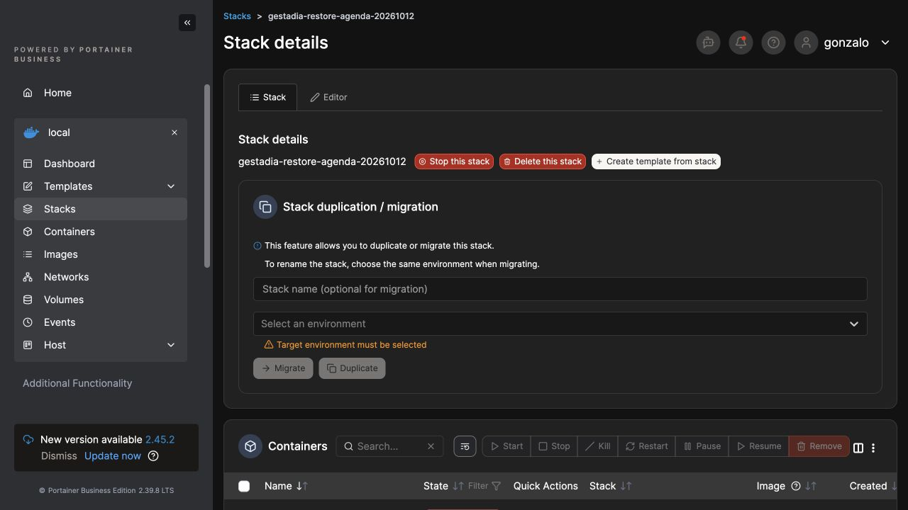

Estado al registrar esta evidencia: intervalo de una hora todavía sin empezar, permisos Portal/LidIA apagados, copia/preparación LidIA pendiente, ninguna Call real acreditada. Después deben coordinarse la caducidad, activación por cuenta/chat, turno al agente, creación/readback Zoho, recuperación del recibo y reapertura de la misma sesión. La demostración segura Playground del otro chat conserva su alcance separado.

Requisito del usuario para uso real: el agente solicita los datos necesarios de forma sencilla y confirma la hora local; no pregunta la zona horaria como campo técnico. Su implementación en LidIA permanece separada de la autorización operativa recibida.

## Preparación del cierre de permisos

La copia nueva de LidIA está creada; su restauración aislada de 198 tablas, vínculo de cuenta/sesión y 11 mensajes externos sigue pendiente del acceso al servidor. Portainer y Plesk se han comprobado de nuevo y ambos muestran Login. La ventana temporal continúa sin activar y ninguna llamada real está acreditada.

El auxiliar operativo `revoke-and-sync.mjs`, conservado en los artefactos privados, usa la transacción de cuenta existente: valida el origen humano bajo bloqueo, retira exclusivamente ese permiso mediante actualización condicionada y encola el contexto en la misma transacción. Antes de enviarlo comprueba que no haya aparecido otra autorización. El ACK debe devolver exactamente `history` y `sondeo`, la conversación y la revisión vigentes.

Verificación local RED/GREEN de diez escenarios: ACK correcto; permisos CRM adicionales, incompletos o duplicados; cambio de autorización antes del bloqueo, durante la actualización condicionada o después del bloqueo; configuración desactivada; cambio de vínculo después del ACK; retirada repetida. Diez resultados correctos con dobles locales; no es una ejecución contra MySQL ni prueba de retirada en producción. Fuente del auxiliar SHA256 `c0e8cb806743863d987278eea9eba0d1805b76c35ea3cd7f1f4ce65ee29d2dc7`; comando regenerado a partir de esta fuente. La revisión se ha trasladado al equipo LidIA.

## Copias actualizadas y restauración verificadas tras recuperar el acceso

A las 13:12 de Madrid se completa una nueva copia de Portal en un directorio independiente, conservando la anterior: SQL de 291449 bytes, SHA256 `7c108c8691485074257f10b5ad05bcaa916289f462cff4c560cd0f046565bcb2`; mismos 45 usuarios, 94 expedientes, 14 documentos y 15 migraciones. Configuración y documentos mantienen sus hashes anteriores. Stack 107: tres procesos con salida 0; stack 108: restauración SQL y de archivos aisladas, sin red, ambas con salida 0 y comparación correcta.

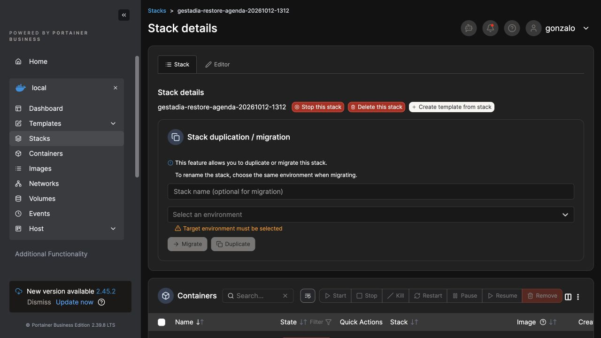

LidIA genera una copia SQL nueva a las 13:11, 1290711503 bytes, SHA256 `a9d35f21d2008b12906b82a367f9f02e4a88f624ec9f9c38063638905467742f`. Runtime SHA256 `baa91c233a7a8ebb2782acc6f1171fc3ce05d8c0a52852585fd03f261bc4fa6d`, configuración SHA256 `abd00800b8bc6bdbed8371f2dbcb3b8610ef9b658847465451c4d6fb26588d2c`; entorno, comando y manifiesto también conservados en el servidor con acceso restringido. La fixture 106 restaura esta copia en tmpfs y sin red: 198 tablas verificadas, vínculo de cuenta/sesión correcto, 11 mensajes APP (2 usuario y 9 asistente), runtime contrastado por manifiesto y configuración/entorno/comando idénticos. Proceso `3b6996c4d470892428683fe66e486e718db5955d0b7ea9125889862ca36709c9` terminado con salida 0.

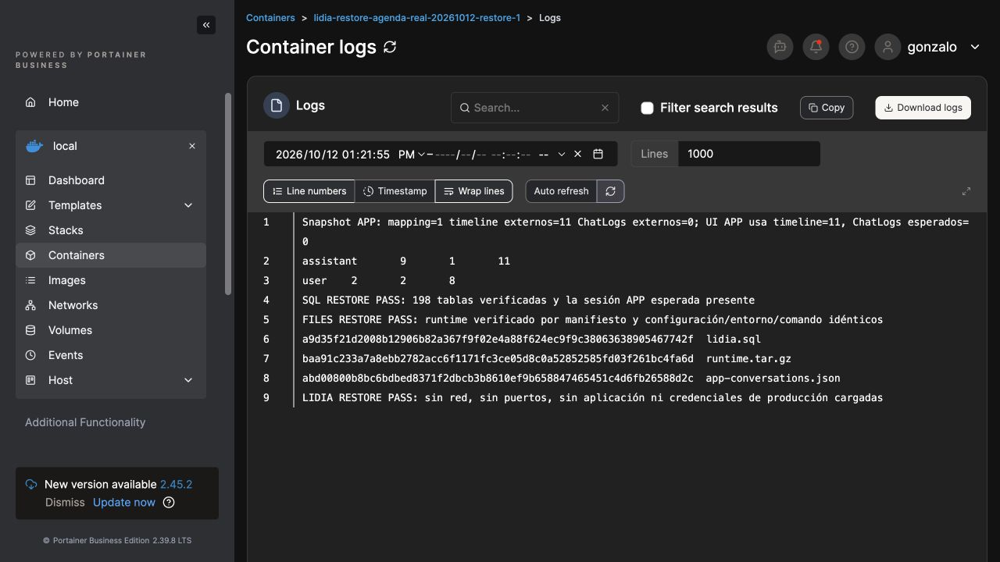

El primer comparador exigía además 11 `ChatLogs` y se detuvo con REVIEW REQUIRED; se conserva ese resultado. La traza de `Detail.razor` → `LoadAppSessionForOperatorAsync` → `AppSupportService.ReadAsync` → `AppTimelineService.VisibleMessages` confirma que el detalle común APP proyecta el timeline autorizado, sin cargar ChatLogs. La corrección del auxiliar conserva la expectativa observada del snapshot: 11 mensajes de timeline y cero ChatLogs para esta sesión. No se modifican la copia SQL, el producto ni sus permisos. Revisión independiente de LidIA conforme.

La comprobación de sólo lectura dentro del backend vigente confirma cuenta activa, permiso temporal ausente, contexto `history`/`sondeo`, revisión 1 sincronizada, flag de llamada apagado y contexto de perfil apagado. Se inicia el despliegue de LidIA V1.726 después de estas restauraciones; al registrar este bloque la ventana UTC sigue sin empezar y no se acredita ninguna llamada real.

## Despliegue y previsualización confirmados

LidIA PRO sirve `V1.726-app-crm-temporal`, commit `0d701051bb776c0fb1c13923b0110b509660a4fa`. Contenedor `6f090e1cd2fc1ade4b71f8fb271188edecc7484552650c1bc20fb660fa833751` saludable, creado a las 13:28 de Madrid. La configuración conserva exactamente el hash original y la misma sesión conserva los once mensajes. El error 504 del proxy durante el despliegue se reconcilió con el estado real; no se repitió la operación.

Diagnóstico de solo lectura: proyecto 103, agente 122, entorno PRO; permisos de integración `sondeo`, `history`, `support_handoff`, sin configuración CRM. El flag `PlatformAgentRuntimeEnabled` está ausente y se conserva: gobierna requisitos de aislamiento, no selecciona otro motor de conversación. Las comprobaciones iniciales del auxiliar asumían incorrectamente el flag activo y únicamente dos permisos; se corrigió el auxiliar a partir de este diagnóstico, sin modificar la configuración real.

La previsualización posterior devuelve `preview_only_no_write` y `ROOT_PREVIEW_READONLY_PASS`, con el hash original y sin cambios de claves ni otras integraciones. Propone conservar los tres permisos existentes y añadir exclusivamente `crm_prepare`/`callback_schedule`, con conexión 4 y alcance de cuenta, sesión e intervalo obligatorio. Regresión local `test-real-baseline.py`: preview, apply y restore preservan el permiso de atención humana, las claves, el flag ausente y los bytes originales tras restaurar. El generador de configuración Portal también conserva DB/JWT/SMTP en un entorno temporal y cambia únicamente los dos ajustes de llamada previstos. Son verificaciones de auxiliares, no una activación real.

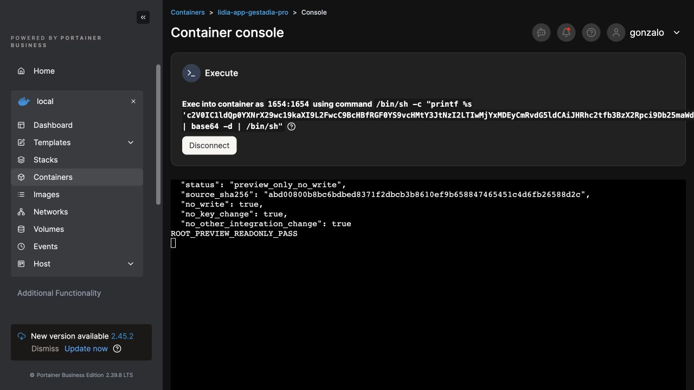

La ventana sigue sin iniciar. Pendiente acreditar la asignación legítima de conexión 4 mediante las herramientas del agente antes del turno real. El usuario autoriza coordinar el chat de pruebas móviles: estado técnico y rutas privadas de firma compartidos, sin claves; su caso DEV con gestor se mantiene separado de esta reserva. TestFlight continúa en (11), Play interno en (3); esta continuación no sube ni publica paquetes móviles.

## Ventana real y cierre verificado

La ventana autorizada se ejecuta el 12/10/2026 de 14:50 a 15:50 de Madrid. Se clonan cuatro herramientas del agente original en el proyecto APP, inicialmente inactivas y sin asignación. La activación atómica y su lectura independiente confirman las cuatro asignadas al agente APP y activas; CRM y agenda usan la conexión Zoho EU 4. No se modifica el agente original ni se activan canales Web. Configuración temporal LidIA SHA256 `8ad1a186a864cc6d99dfec27b8e32a049524b4aa96b765dd1e6fc0f6791bd2a2`; conserva permisos originales y exige cuenta, sesión e intervalo exactos.

Portal genera un archivo de entorno temporal y cambia únicamente ese bind en el stack común. La concesión real y su ACK confirman revisión 2 sincronizada con exactamente `history`, `sondeo`, `crm_prepare` y `callback_schedule`. Se envían tres turnos por la misma conversación con los datos autorizados y petición de llamada informativa. La captura rechaza inicialmente «autorizo»; una expresión natural admitida finalmente deja el consentimiento verdadero. El agente devuelve el aviso de registro no verificado. La lectura del estado propio mantiene vínculo CRM y cita confirmada ausentes, sin intentos durables en el ledger hasta la última comprobación de las 15:38. Los tool calls observados incluyen disponibilidad y agenda; no equivalen a una Call creada. **La llamada no está acreditada ni se declara agendada.**

Antes del final de la ventana se ejecuta la retirada canónica en Portal: concesión ausente y ACK de revisión 3 sincronizada, con exactamente `history` y `sondeo`. Se restaura el bind original del stack común. Backend, APP y Portal saludables; lectura independiente posterior confirma cuenta activa, concesión ausente, revisión 3 sincronizada y flags de llamada y contexto de perfil apagados.

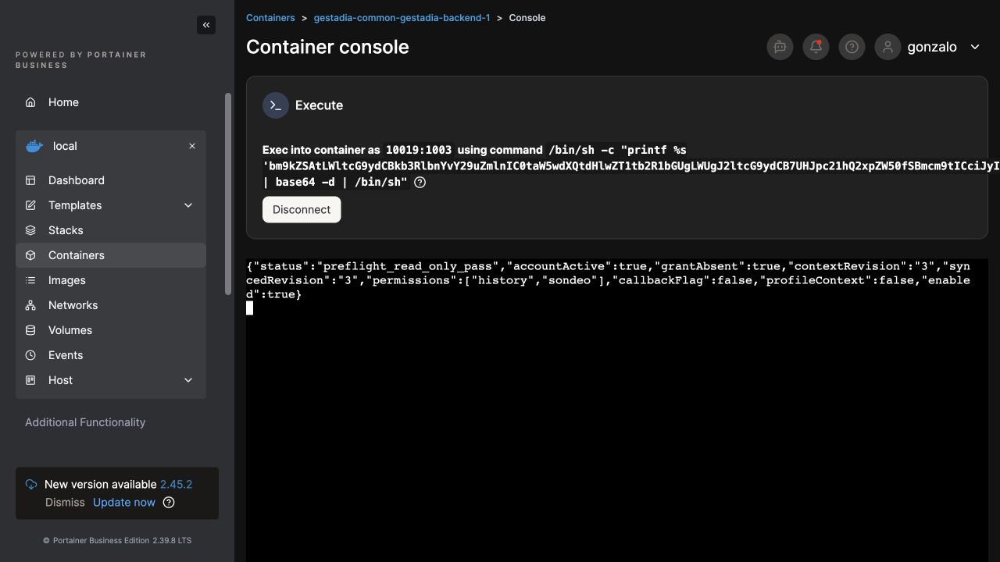

LidIA restaura la configuración original byte a byte, SHA256 `abd00800b8bc6bdbed8371f2dbcb3b8610ef9b658847465451c4d6fb26588d2c`; conserva los tres permisos originales. Se retiran las cuatro asignaciones temporales y las copias quedan inactivas. No se borran mensajes ni expedientes, no se modifica el agente original y no se realizan peticiones CRM durante la retirada. El contenedor vuelve a estar saludable después del reinicio.

Las trazas completas y datos personales permanecen privados. Continúan la corrección local del consentimiento explícito y la investigación del fallo previo a persistir la cita; no se relaja el guard de confirmación ni se inventa un país del carné para seguir el canje antiguo. No se reabre la ventana sin una nueva autorización humana. TestFlight (11) y Play interno (3) permanecen sin nuevas subidas en esta continuación.

## Regresión local de consentimiento tras el cierre

Se prepara en el worktree LidIA una corrección limitada a `CaptureAppContactVariableAsync`: reconoce «autorizo que me llaméis» y variantes explícitas de llamada propia; las negativas prevalecen, también con pronombres y saltos de línea. No acepta un «sí» genérico ni autorización de publicidad o llamada a terceros. La retirada se comprueba partiendo del consentimiento verdadero. Se conserva el control de autoridad y el estado tipado.

RED observado con el pipeline real del Harness: seis fallos en los doce casos iniciales, cuatro en los dieciséis tras añadir pronombres y dos en los dieciocho tras añadir saltos de línea. GREEN final de `AppCrmPreparationTests`: **186/186**, cero fallos y omitidos, salida 0; `git diff --check` correcto. Son pruebas locales, sin CRM remoto; la compilación mantiene avisos existentes de dependencias y código. Fuente productiva comprobada SHA256 `17acd76329fc02c097b39fc96f42481f8441266f2d782030f84bfc648f4c46e0`; prueba SHA256 `6c2c48b52a9d7d44046774fd92079f02f5b1d5146b5e3712c140311750184152`. Entrega al equipo LidIA para revisión e integración, todavía sin commit funcional ni despliegue en esta evidencia. La causa precisa del fallo posterior de agenda sigue en investigación; no se acredita la llamada.

## Revisión ampliada y límite real de los registros

La revisión posterior detecta dos huecos que no cubría el grupo anterior: un consentimiento previo verdadero sobrevivía a una negativa si el modelo proponía verdadero, y la agenda directa podía usar ese estado sin capturar otra variable. Se reproducen cuatro fallos y un control correcto. LidIA retira el consentimiento al admitir la negativa antes del modelo y lo comprueba de nuevo al preparar CRM para llamada, normalizar agenda y capturar una propuesta contradictoria. Revisión del diff conforme; el equipo confirma **196/196** pruebas CRM/Core/marcador, cero fallos y omitidos, Release sin errores con los 172 avisos existentes. PR 1646 integrada en `dev/IA/main`, commit `067ec1cdc`; esto todavía no acredita desplegar ni reservar. Los hashes y 186 pruebas anteriores conservan su alcance de revisión previa.

El lector privado se revisa, corrige para redactar valores ajenos a booleanos y preservar utilidades e informes anteriores, y se ejecuta una sola vez. Script SHA256 `30e7e734c81c9b337b7119ed12d1d2b9f95b48660d7ce813f75f75b8daeabde3`, archivo comprimido/base64 SHA256 `a1f8beb82d6c476b5f5f64e8d3122e7c1169488f419642bc237de40e8bd9ad27`, DLL SHA256 `7085f14ce5e37a7e47f73de17cd4fb5e8091a59f41a2d712015819d1d2254031`. Su fixture puro pasa localmente antes de subirlo; el script comprueba los tres binarios y repite la fixture antes de las consultas SELECT. No consulta tokens, no escribe DB y no hace HTTP CRM. Informe nuevo en el directorio privado, sin sobrescribir el anterior.

Lectura agregada del informe existente: vínculo de cuenta/sesión correcto; **10** registros de proveedor, solicitudes de **112–113** caracteres y JSON válido en los diez; sin outputs de herramientas ni definiciones completas retenidos; vínculo CRM y cita confirmada ausentes, ledger vacío. La traza de `AnthropicChatBackend.Record` → `BuildRawRequestSummary` confirma que se guarda únicamente modelo, parámetros y recuentos: no es truncado ni demuestra ausencia de herramientas ejecutadas. Las respuestas sí registran sus llamadas; el error exacto de agenda no puede recuperarse de estos resúmenes.

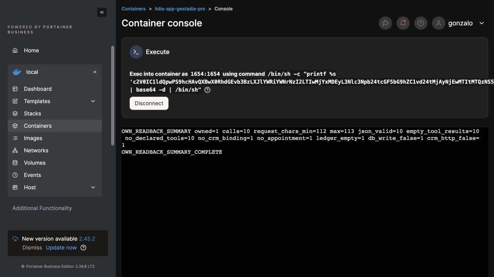

Dependencia pendiente: no hay evidencia de metadata Zoho que acredite la existencia y unicidad de `LidIA_App_Owner_Key` en Leads/Contacts de conexión 4. El valor temporal `UniqueOwnerKeyConfirmed=true` del auxiliar no acredita esa propiedad. La configuración original está restaurada y no se cambia esquema ni mapeo. Antes de una nueva ventana se prepara trazabilidad segura de errores de herramientas en un volumen privado persistente y debe validarse el campo/conexión. La causa exacta y la llamada real siguen pendientes.

## Metadata administrativa y siguiente despliegue preparado

La aprobación de una hora limita los permisos de contacto/agenda de la cuenta APP; no cierra la preparación administrativa de esquema con acceso existente. En `/admin/settings/crm-mapping`, la opción de producción se verifica como conexión 4. Se usa exclusivamente «Obtener Campos», sin guardar mapeos: Contacts devuelve 153 campos y Leads 171, con campos estándar y `LidIA_App_Owner_Key` exacto en ambos. Esto acredita existencia; la UI descarta las propiedades `unique` y `length`, por lo que no acredita unicidad. No se consultan registros de clientes ni se amplía OAuth.

LidIA prepara V1.728: rechazos de captura, fecha, preparación y referencia CRM dejan códigos seguros en `App_Data/logs/app-tools-.txt`, sobre el volumen privado persistente, con siete ficheros de un MiB y sin argumentos/texto de cliente. Equipo confirma 199/199 y Release NET8 sin errores (174 avisos existentes), PRO integrada en `8bab2547d9b7ffb73e7c76ffaa8032ce9aee419a`. Nueva copia pre727 con 198 tablas, SQL de 1289559563 bytes, runtime de 42779133 bytes, configuración original y siete hashes verificados. **Runtime observado continúa V1.726; el despliegue aún no se ha ejecutado.**

La lectura por SID del ledger confirma solamente el ámbito de agenda: el ledger de alta Lead usa `crm-owner:` y el hash del namespace/proyecto/entorno/cuenta. No acredita cero efectos Lead. Se prepara y revisa una lectura adicional exclusiva de ese owner/conn4, sin HTTP CRM ni consultas de tokens. Al pulsar Connect la sesión de Portainer caduca; resultado de esa ejecución **desconocido**, pendiente de reconciliar directorio/proceso/informe antes de repetir. Un único inicio de sesión con las credenciales existentes del navegador falla; se solicita una recuperación humana en este chat y se avisa al equipo para no duplicarla ni desplegar.

El helper privado `AppCrmMetadataReadback` está preparado localmente con SDK8: build sin errores, fixture de proyección/redacción/HTTP GET exclusivo correcta, sin DB ni red. La fuente bloquea `SaveChanges` y solicitudes distintas del GET fijo de metadata Leads/Contacts; no arranca Host ni Seeder. Su paquete conserva informes previos y exige hashes de las bibliotecas servidas. Todavía no se ha ejecutado en servidor ni acredita propiedades de los campos. Contacto/agenda siguen cerrados y la llamada real no está confirmada.

## Acceso recuperado y ledger de contacto reconciliado

El usuario confirma el inicio de sesión y se recupera Portainer con el usuario existente. La comprobación previa encuentra ausentes tanto el directorio del lector como su informe y cero procesos del auxiliar exacto; por tanto la operación incierta anterior no llegó a dejar una ejecución. Se ejecuta una sola vez el paquete revisado: script SHA256 `6db083e2384a86b0030311f42bddfe81f4450e0a25d09494f3ea2e4341baffac`, transporte comprimido/base64 `ab706efc010044e045c0258f44d5afc6cf173a0d82a7083cbf371941ac4cbda9`, DLL `f99cad9c2b698c8f1a52db72222e43b518635fada720fb49bf06560265397629`. El informe nuevo acredita `owned_session_read_only`, `owner_ledger=[]`, vínculo CRM y cita confirmada ausentes, sin escritura DB, HTTP CRM ni consulta de tokens. La lectura queda completada; el ledger vacío de ese owner/conexión tampoco acredita por sí solo la ausencia de cualquier registro en Zoho.

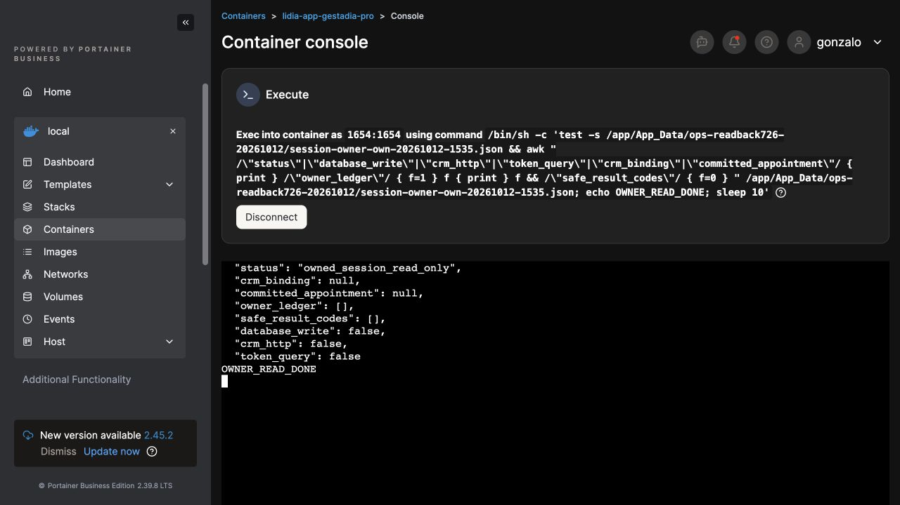

La revisión independiente del paquete final de metadata verifica los tres binarios y los hashes de fuente/transporte. Fixture y preflight nativo pasan con el DLL final: construyen configuración, modelo EF y servicio Zoho, bloquean las cuatro variantes de SaveChanges y no ejecutan SQL ni HTTP. El script exige repetir ambas comprobaciones contra las bibliotecas reales y sus seis hashes antes de consultar metadata. Todavía no se ha ejecutado en servidor.

Se cede Portainer al equipo LidIA para comprobar la restauración de la copia SQL reciente antes del único despliegue autorizado de V1.728. La recuperación del acceso no renueva la ventana CRM de la cuenta APP. Permisos cerrados, sin nueva subida móvil ni llamada acreditada.

## Restauración reciente antes de V1.728

La sesión de Portainer del equipo está aislada; la operación se realiza en este chat, sin pedir otro inicio de sesión. La primera fixture, stack 110, termina con salida 1 antes de importar SQL: el verificador llevaba mal transcrito el hash del runtime, con 63 caracteres. Se conserva esa evidencia y el verificador original; no se despliega producción. La lectura independiente de los archivos reales confirma SQL SHA256 `63e10fff7cec4103bfd18ee99f319b494cf745b756083e298c04c67f40a48e87`, runtime `ae47ab8dce4f83da7baaf34662595277c830172e39a186227b5cb942ed30a3c1` y configuración original `abd00800b8bc6bdbed8371f2dbcb3b8610ef9b658847465451c4d6fb26588d2c`.

La revisión nueva corrige únicamente ese pin y añade un marcador explícito tras comprobar los hashes. Los tres pins tienen 64 caracteres hexadecimales, Compose valida la configuración y la revisión independiente confirma el diff. YAML SHA256 `f991c1be5421452de1711541e4ecbd4231344f545d040c5603dc98e46146a2ad`.

Stack 111, contenedor `55a4bc5a2ccdf23f4f9decf8ad78db5f22062e8776fff044c19969a828f21d2f`: restauración aislada de la copia pre727 reciente completada el 12/10 de 18:38:21 a 18:39:38 de Madrid, **salida 0**. SQL RESTORE PASS: 198 tablas, vínculo 1, 19 mensajes externos (14 asistente y 5 usuario), ChatLogs 0. FILES RESTORE PASS: runtime contrastado por manifiesto y configuración, entorno y comando idénticos. Sin red, puertos ni aplicación en esa fixture.

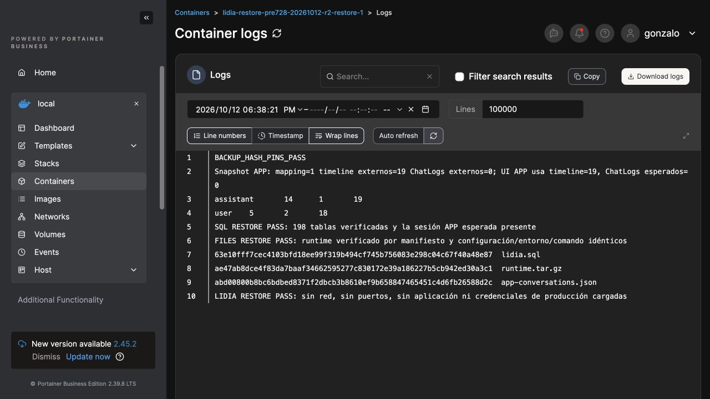

Después de ese resultado se inicia una única actualización Git de stack 26, con la rama `produccion/gestadia` verificada en `8bab2547d9b7ffb73e7c76ffaa8032ce9aee419a`. Este registro de inicio no acredita por sí solo el nuevo runtime servido. No se modifican los permisos temporales ni las herramientas del agente.

## V1.728 servida y unicidad CRM comprobada

La única actualización devuelve un 504 al navegador y, durante la reconciliación, el archivo Compose aparece temporalmente inaccesible. No se repite Pull. Después de esperar y recargar, stack 26 muestra `8bab2547d9b7ffb73e7c76ffaa8032ce9aee419a`, contenedor nuevo `26d8088243ffe855abaa26284a22a3a15a6604f47252efd4d2c7c3aca0e8b071` saludable y el sitio sirve `V1.728-app-diagnostico`. La configuración original conserva SHA256 `abd00800b8bc6bdbed8371f2dbcb3b8610ef9b658847465451c4d6fb26588d2c`.

El helper administrativo final se ejecuta una vez tras comprobar directorio e informe ausentes. Los seis hashes de dependencias servidas, fixture y preflight nativo pasan en el contenedor nuevo. Dos GET de metadata confirman el campo exacto en Leads (171 campos) y Contacts (153): texto, longitud 64, sin flags de sólo lectura. La proyección inicial no interpreta `casesensitive` como texto y conserva null; ese primer informe permanece intacto.

La [documentación oficial V2 de Zoho](https://www.zoho.com/crm/developer/docs/api/v2/field-meta.html) ejemplifica `unique.casesensitive` con la cadena `"0"`. Revisión R2 limitada a la proyección y sus fixtures: normaliza exclusivamente booleanos y cadenas `0`, `1`, `true`, `false`; informa número, nombres y tipo de propiedades sin copiar valores arbitrarios. Diez formas de metadata se comprueban antes y después del cambio. Fixture y preflight con el DLL publicado pasan localmente desde el directorio previsto; los primeros comandos desde otro CWD o con un argumento local no admitido fallaron y no ejecutaron SQL ni HTTP. Script SHA256 `07382ab859fe76685a2608025c336b7894bd2887f64174a5fddb615b652349b5`, transporte `062788f834af598602a5712a668c13168633d34b636b32057bb7cc81aefacf6f`, DLL `9808ff2468432774ab479b9107df00878f8914ae52699de2ed694e534e697e2b`.

Lectura real R2 del 12/10 a las 16:54:04 UTC, tras hashes, fixture y preflight contra `/app`: ambos módulos devuelven `unique` con una propiedad `casesensitive`, de tipo cadena, normalizada a false. Se acredita la unicidad configurada en ambos campos, sin distinción de mayúsculas, con la misma longitud 64. Informe nuevo SHA256 `1c530dbeba196045fc04b9ec5b5c12d8d0fdc67de03ebe2dde6019bad1d0024c`. Dos GET, cero registros CRM consultados, cero escrituras DB, cero POST OAuth y permisos APP intactos. No se guardan mapeos ni se modifica el esquema de Zoho.

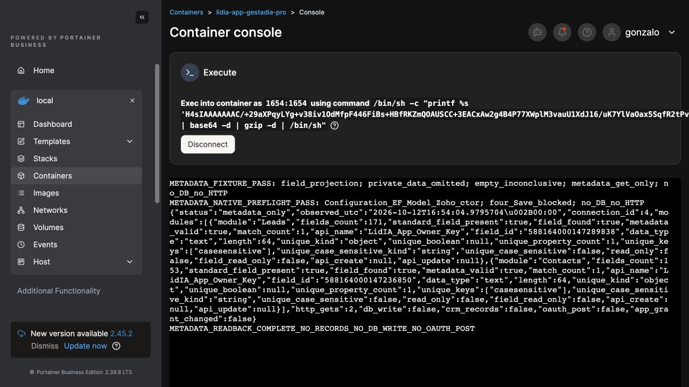

La hora anterior sigue cerrada. Se preparan nuevas copias de Portal/LidIA y una ventana revisable con V1.728 antes de solicitar una nueva autorización de una hora. **La llamada real sigue sin reservarse.**

## Copias y previsualización de la segunda prueba

Portal, copia nueva del 12/10 a las 16:56:05 UTC: SQL 298263 bytes, SHA256 `1c8a9fbfa103dbf30fdce70df2afe7e30d94ac955e3ae31060999ea53a639228`, 45 usuarios, 94 expedientes, 14 documentos y 15 migraciones. Stack 112 termina sus tres procesos con salida 0. Stack 113 restaura SQL sin red/eventos: 24 tablas correctas y los mismos recuentos; configuración, claves y documentos coinciden byte a byte. Ambos procesos de restauración terminan con salida 0.

LidIA, copia SQL nueva `manual_20261012_165647.sql`, terminada a las 16:57:11 UTC, conservada junto al runtime V1.728, configuración, entorno y comando. Siete hashes, tar y comparaciones correctos; permisos 700/600, UID 1654. La primera fixture de esta copia, stack 114, se detiene antes de importar por otro error de transcripción visual del hash SQL. Se conservan el intento y sus valores. Para eliminar esa fuente de error, stack 115 audita la copia en modo lectura y sin red: siete OK, salida 0 y hashes obtenidos de los logs de texto mediante extracción automática.

Valores exactos del texto real: SQL 1290700177 bytes, SHA256 `f2d888d433c5c24f2dae49bba3e68b740728929d0682a0e16a00fe69a4fd0d42`; runtime 42788484 bytes, SHA256 `074d7f6f986bd388137fa42489d5dbcd0f8bae91585617dbdf5bebd94bd94c83`; configuración original SHA256 `abd00800b8bc6bdbed8371f2dbcb3b8610ef9b658847465451c4d6fb26588d2c`. El nuevo YAML cambia exclusivamente el pin SQL desde ese texto, conserva el anterior y pasa revisión/Compose; SHA256 `e62c674491e589bc77ae997393887373444fa004dad258b71800c0006101f3aa`.

Stack 116, contenedor `bc4fb730ce7dff34ba454b9a5038ba64b227e908e9b45ad3a1ca0168ac265504`: **restauración real terminada con salida 0**, 198 tablas, vínculo 1, 19 mensajes (14 asistente y 5 usuario), ChatLogs 0; runtime verificado y configuración, entorno y comando idénticos. Sin red, puertos ni aplicación en la fixture.

Editor privado V1.728 subido una vez a un directorio nuevo, sin ejecutar apply: DLL SHA256 `133725a406d0ebdf7f42cc96dd259c5f9b703a2af000a71eaafcb58e0a93a9b5`. La previsualización devuelve `preview_only_no_write`, fuente original, sin cambios de claves ni otras integraciones. La lectura administrativa de conexión 4 verifica literalmente Provider `Zoho CRM`, Environment `Production`, IsActive true. Se descarta esa posible discrepancia de entorno, sin atribuirle el fallo anterior. La propuesta incluye CRM y agenda ligados a un alcance válido; todavía no está aplicada.

El generador Portal nuevo conserva la evidencia anterior y usa otro archivo de entorno. Revisión local y del equipo: YAML con saltos reales, sólo dos flags sustituidos, resto del entorno preservado y archivo 600; el argumento de ejecución mantiene literalmente `db.$disconnect()` mediante comillas POSIX, probado con un stub sin Prisma/DB/red. Caducidad y referencia humana definitivas quedan pendientes de aprobación; no se genera ni ejecuta una concesión real en estas comprobaciones.

La APP conserva la sesión autenticada y el mismo historial al recargar. Queda comprobar las cuatro copias de herramientas y formular una única renovación humana de una hora. **Permisos cerrados; llamada aún no agendada.**

## Preparación cerrada y renovación humana pendiente

La UI de Tools lista sólo herramientas activas y no permite acreditar por sí sola las cuatro copias inactivas. Se revisa y ejecuta una vez un lector administrativo mínimo, sin modificar el editor: SELECT fijo de IDs 10368–10371 dentro del proyecto 103, estado, conexión y recuento de asociaciones; no lee contactos ni tokens y no hace HTTP. Snapshot original verificado por SHA256 `d2a3ff56c079c0c86acf1ca843a178fa11d6b720512986492c235950ed50919a`; DLL del lector `5131d1134309dfe0367ce99081f870a0cbe3bd42b0f84ef68e25b524bee94ce7`, paquete `69b17c2bf3710b586650e28aa3c7aee5bc7fb6f87c86d017daeaa72709466cae`. Directorio/informe nuevos, sin sobrescritura.

Resultado real: las cuatro copias existen, están inactivas, no son globales y tienen cero asociaciones al agente APP o a cualquier otro. Tres usan conexión 4; el comprobador de país conserva conexión null. Informe `tool_metadata_read_only`, `ready_for_future_activation=true`, sin escritura DB, HTTP CRM, consulta de tokens ni de contactos.

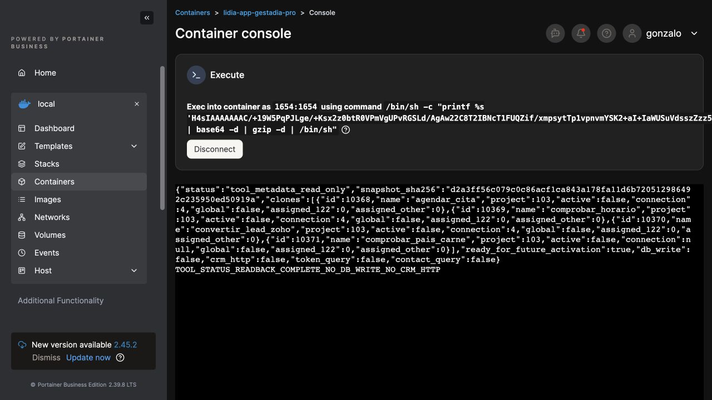

Con runtime V1.728 servido, copias/restauraciones completas, metadata y entorno Zoho acreditados, previsualización y herramientas verificadas, se presenta **una única pregunta humana** para renovar una hora, exclusivamente en la misma cuenta/conversación y conexión 4. La petición conserva los datos y horario reales ya aportados, sin pedir país del carné. La ventana nueva todavía no empieza: pendiente de respuesta; no se aplica configuración ni se activan herramientas o concesiones por iniciativa propia. **La llamada continúa sin agendar.**

## Segunda ventana autorizada: activación y primer turno real

Respuesta humana directa `human:call_37239e27ed314de1b007a4762947ca66`: habilitar una hora y agendar la llamada. Ventana común 12/10/2026 18:05–19:05 UTC (20:05–21:05 Madrid); misma cuenta y conversación, conexión Zoho EU 4. Registro de autorización y datos de contacto permanecen privados.

LidIA aplica el alcance con CAS sobre la configuración original y editor V1.728; resultado SHA256 `8014843dd818240962f6edf9265320e9e055c54161d2d59aa932a1a7754508c8`. Un intento previo de transporte se rechaza por sintaxis antes de ejecutar el script; el transporte base64 conserva los bytes y completa apply. Único reinicio del contenedor; V1.728 vuelve a servir. Cuatro herramientas asignadas exclusivamente al agente APP; activación devuelve `tools_activated_for_scoped_app`, assigned 4, sin HTTP CRM.

Se detecta en el generador privado Portal un escape literal de salto de línea en el código del archivo de entorno. Se corrige a `String.fromCharCode(10)` y una fixture con el comando real generado verifica saltos independientes, claves originales preservadas y una sola definición de cada flag. Stack 117 termina con salida 0. Archivo privado nuevo SHA256 `9dbfe147d218427fb2812e629b35a5a24e5283f038b975f4174335d4dcd126c7`. La primera lectura DOM del compose era parcial por virtualización; se obtiene el contenido completo copiando las 79 líneas y se comprueba que sólo cambia el bind del archivo de alcance. La primera actualización no queda reflejada al reconciliar config y contenedor; se vuelve a aplicar la edición visible. Backend nuevo `cc01a166d120b019d3585934963bbe7fdcbe35cd48b8bd9b9661e4351b651ee7`, saludable y con bind nuevo. No se repiten grants ni mensajes de resultado incierto.

La concesión comprueba el hash del archivo privado, flags, identidad, alcance y hora antes de escribir. ACK real: revisión 4 sincronizada 4; permisos exactos `history`, `sondeo`, `crm_prepare`, `callback_schedule`, caducidad 19:05 UTC. Un único turno APP a las 18:07 UTC solicita la llamada informativa real del 13/10 a las 10:00 Madrid, con consentimiento de contacto y llamada y sin solicitud de canje. LidIA responde que el registro no está verificado.

El lector del resultado se ejecuta una sola vez, sin escritura DB ni HTTP CRM. Log seguro V1.728: `PrepareAppCrmAsync` rechaza con `crm_owner_resolution_required` a las 18:07:46.197 UTC; `ExecuteAppAppointmentAsync` devuelve el mismo código a las 18:07:46.249 UTC. Se solicita diagnóstico acotado y lectura del ledger antes de cualquier reintento. **La llamada no está acreditada ni se da por reservada.** Los permisos se retirarán tras finalizar la prueba o al vencer la hora.

Lectura compacta del mismo reporte existente, sin repetir SELECT ni HTTP: `crm_binding=null`, `committed_appointment=null`, `ledger=[]`, `owner_ledger=[]`. Esto acredita ausencia de claim/efectos registrados en esos ledgers, sin afirmar por ello que no exista un contacto anterior en Zoho. Se solicita lectura CRM acotada que discrimine coincidencia legacy, propietario ambiguo y paginación ambigua.

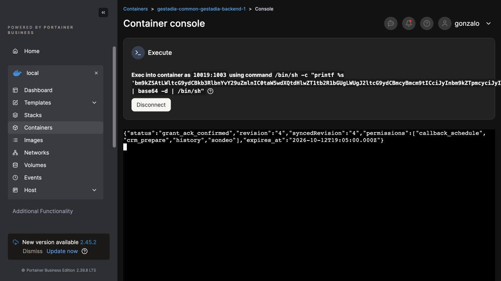

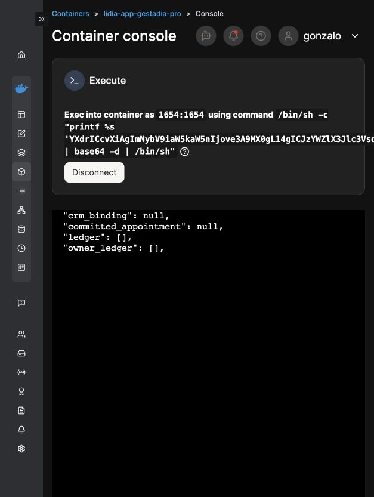

## Diagnóstico CRM real: contacto legacy sin atribución acreditada

Lector privado revisado y ejecutado una vez bajo la misma ventana, hash de configuración aplicado y conexión 4 Production/EU. Fuente SHA256 `dd8d75188e28cfb9591dce0011c65201bc2ddc79cbfcae21074c4a99f2d9a967`, script `19903368c43949b90d0ca1bc2fb5d299c2141285411dd03a8e53ba8cc5d580d0`, DLL `00e45c5fd4139eaf949ed3a932f72c0980f1171f7d1c75d13a3ad3aa9337d93a`. Preflight servido correcto, cuatro variantes de SaveChanges bloqueadas; cliente HTTP sólo permite cuatro GET exactos y sin redirecciones, bloquea POST OAuth y cualquier escritura CRM.

Lectura del 12/10 18:15:48 UTC: búsqueda de clave de propietario sin resultados en Leads ni Contacts (204). Búsqueda por variantes del teléfono devuelve una fila en cada módulo, sin más páginas. El Lead no coincide exactamente con nombre, correo ni teléfono normalizado; el Contact sí coincide en teléfono, pero no en nombre ni correo. Ambos carecen de clave de propietario. Los IDs de esos registros quedan ocultos en el informe porque no se acredita la atribución por los tres datos ni por la clave propia. Cuatro GET, cero escrituras DB/CRM/OAuth.

Se identifica una coincidencia legacy no atribuida como motivo del rechazo, sin ambigüedad de paginación ni de clave propia. No se vincula por teléfono ni se crea un duplicado para sortear el guard. Se pide al usuario únicamente el nombre/correo de su ficha anterior, si existe, para contrastarla. La reserva sigue pendiente y no hay cita confirmada; la retirada de permisos está preparada.

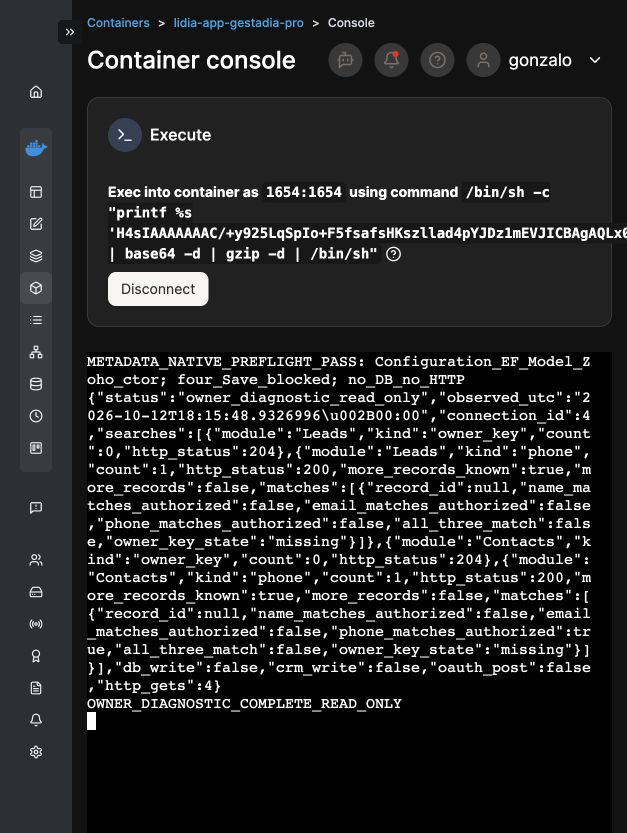

## Cierre físico de la segunda ventana

Sin resolver la atribución del contacto, se retira el acceso antes de finalizar la hora. Revocación con comprobación de la nueva referencia humana y preservación de concesiones concurrentes: `withdrawal_ack_confirmed`, revisión 5 sincronizada 5, ACK admitted y permisos exactos `history`, `sondeo`. La solicitud queda en la misma conversación; no se repite el turno ni se modifica el Contact encontrado.

LidIA restaura las cuatro herramientas a inactivas y sin asociaciones al agente 122; cero definiciones eliminadas y agente original 119 intacto. Configuración restaurada byte a byte contra la copia V1.728, SHA256 original `abd00800b8bc6bdbed8371f2dbcb3b8610ef9b658847465451c4d6fb26588d2c`, sin cambios de claves u otras integraciones. Reinicio único de retirada; V1.728 vuelve a servir y el contenedor queda healthy. Lectura independiente de las cuatro filas, informe nuevo `tool-status-after-phase2.json`: todas inactivas/no globales, cero asociaciones propias o ajenas, snapshot original idéntico; sin escrituras DB, consultas de contactos/tokens ni HTTP CRM.

Portal restaura sólo el bind del archivo de entorno original mediante comparación del compose completo aplicado; conserva imágenes, claves y volúmenes. Backend nuevo `a9a9f784a190716b6b154336ad4b99cc5e8802c120dd0243faab26806e9ec8d7`, healthy; APP y web Portal healthy. Readback final: cuenta activa, grant ausente, revisión 5 sincronizada 5, `callbackFlag=false`, `profileContext=false`, integración habilitada y permisos `history`, `sondeo`. La APP autenticada conserva tras recargar el único turno de las 20:07 Madrid y su respuesta en la misma conversación.

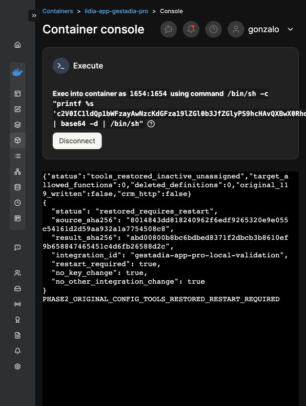

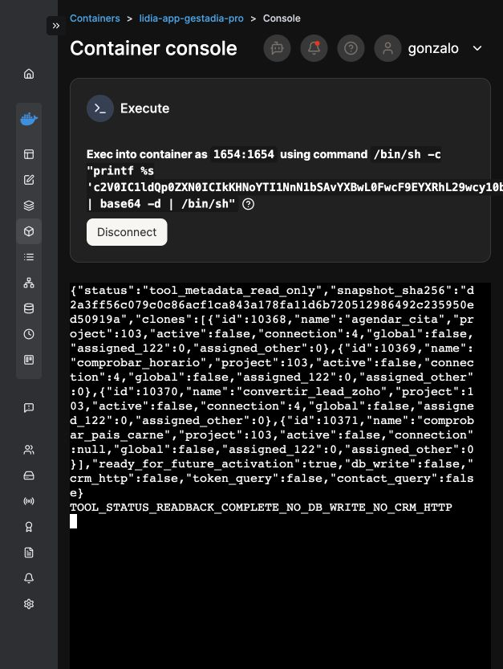

**Resultado: prueba real ejecutada y bloqueo legacy localizado; llamada aún sin reservar.** Pendiente de la información humana solicitada para acreditar la ficha previa y preparar una asociación administrativa revisable. No se elimina ni se modifica ningún registro CRM. TestFlight (11) y Play interno (3) permanecen sin nuevas subidas.

## Inventario DEV para la coordinación de pruebas móviles

Después del cierre PRO se revisa el lector `DevRuntimeAudit`, sin Host, Seeder, EF ni HTTP: SELECT de metadatos, rol del operador y recuentos, sin contactos ni credenciales; artefactos nuevos privados 700/600. Fuente SHA256 `59cf73925b4e4c83536b090974c5521f66bb84ef7509bd76e3f6392f9782a69a`, script `efe18748ac2bca16fe7191fc106a640228efd037e4b4dc43c98e0ceac18b722c`, DLL `b74d5308971f3c91d3ee8792c9922abd9dc0b756320326204a744c5618a597b4`. Se corroboran ambos contenedores y volúmenes en UI antes de una sola ejecución por entorno. No se activa APP ni se modifica configuración, OAuth, registros o colas.

| Dato observado | Stack 24 | Stack 25 |
| --- | --- | --- |
| Nombre | lidia-vozenter-dev | lidia-gestadia-dev |
| Versión servida | V1.705-usuarios-departamentos-ui | V1.705-usuarios-departamentos-ui |
| Base conectada | lidia_v360_dev | lidia_gestadia_dev_db |
| Informe SHA256 | a31047bc5d958757d0574c2a831eeff9b9d6f79506a237b79d52ff380dac3b6e | 8005593eedb108a48268c86f99264ade68507073770baf807375a04067a8858c |
| Conexión CRM activa relevante | Zoho 2, Production | Zoho 4, Production |
| Host CRM observado | www.zohoapis.eu | www.zohoapis.eu |
| Operador Integraciones | 1, rol Admin | 1, rol Admin |
| Fichero APP / overrides env | Ausente / 0 | Ausente / 0 |

Las huellas de destino DB son distintas entre los dos DEV; no se ha medido en este lector la huella PRO. El nombre o `ASPNETCORE_ENVIRONMENT=Development` no prueban aislamiento externo. Fichero APP ausente y cero overrides tampoco prueban la configuración efectiva completa. Stack 24 contiene proyectos y conexiones de Vozenter; no se selecciona por defecto como QA de Gestadia. Stack 25 contiene proyecto 102 `GestadIA v2`, con conexión 4 Production y canales heredados: **candidato a preparar, no entorno aislado acreditado**. El agente 119 existe en ese proyecto; su ID 122 ya corresponde a otro agente y no equivale al clon 122 de PRO.

Una lectura provisional de las filas de cola se había descrito como pendiente en comentario; se rectifica al consultar las definiciones del código: OutboxStatus 1 corresponde a Sent (21 filas en 24) y EvaluationJobStatus 2 a Completed (2 filas en 24). Stack 25 devuelve esos recuentos vacíos. Son datos históricos, no prueba de desactivación de procesos futuros ni de estado enum medido por reflexión del runtime.

Los informes originales se recuperan desde binds de archivo RO y un lector sin red, sin repetir SELECT. Primer lector, stack 118, conserva hashes pero Compose sustituye una variable de comando y falla la lectura; segundo, stack 119, obtiene texto que Portainer transforma de JSON a key=value incluso al descargarlo. Se preservan ambos. Tercero, stack 120, transporta los bytes en base64 con tags fijos; salida 0 y ambos hashes coinciden exactamente con los archivos originales. Los datos íntegros quedan privados.

Metadata de stack 25 comprobada en UI, sin guardar ajustes ni redeploy: repositorio Gestadia_LidIA, referencia `refs/heads/desarrollo/gestadia`, commit desplegado mostrado `64ced36a9a7d98edf1936cb27814d6d822814279`, `compose.yaml`; imagen `lidia-app:gestadia-dev`, contenedor `9b0062d3e2ac76d391ba65c0c7de758acd3344e9c912d73880fb177e2ba53cb7`. Puerto 8084 → 8080/tcp, IPv4/IPv6; APP_UID 1654, GID no observado. App_Data y Logs tienen binds propios bajo `/var/lib/lidia-stacks/gestadia-dev`. GitOps está habilitado; una actualización futura debe contemplar su comportamiento, copia/restauración propia y revisión previa.

Ambos equipos reciben archivos y hashes. Se plantea para 25 una integración APP propia inicialmente limitada a history/sondeo, con proyecto/agente/namespace propios y CRM deshabilitado hasta disponer de Sandbox real y mapping probado. Es propuesta de preparación, **no activación realizada**; móviles y PRO mantienen su estado anterior.

## Nueva petición humana para aclarar la ficha CRM

El usuario confirma que el móvil es suyo y solicita consultar al agente de Gestadia LidIA los datos mínimos del Lead/Contact para determinar si son residuales y evitar errores. Se transmite esa solicitud para una lectura administrativa acotada de conexión 4, sin datos de expediente, notas, credenciales, escrituras, vinculación ni nuevo turno. Deben distinguirse formatos nacionales/internacionales del teléfono antes de atribuir un resultado. Cualquier dato de contacto recuperado permanecerá privado; la llamada aún no está reservada y los permisos APP temporales siguen retirados.

## Consulta residual completada, selección humana pendiente

La nueva lectura administrativa mínima se revisa y ejecuta una sola vez con configuración original cerrada y conexión 4 EU: `AppResidualContactReadback`, fuente SHA256 `dffee86c7382d9bcc5abc7d3fefa7c61f61027b696534ce79c12389827e1d878`, DLL `cde7db55d6e5a6ca9ae6051a69e1e45cdb69093f8aac1600e8d0960486c78473`. Preflight servido PASS, cuatro Save bloqueados; dos GET exactos de búsqueda por variantes, máximo 20 filas y sin redirecciones/POST/refresh. Resultado 12/10 18:50:31 UTC: una fila en Leads y otra en Contacts, sin más páginas, ambas sin clave de propietario. El teléfono nacional del Lead corresponde a una variante autorizada, por lo que el booleano internacional false de la lectura anterior no acredita un teléfono ajeno.

Nombre/correo/teléfonos/IDs/fechas se guardan únicamente en el informe privado y se muestran al humano que los solicitó. Bytes originales recuperados sin repetir Zoho desde un bind de fichero RO, actor 1654, sin red; stack 121 salida 0. SHA256 real del informe `7aaeef756a4784ac436d513c2320f652c289d7d963ce29717c28ab98171da9ea`, comprobado directamente contra el hash de servidor. El agente LidIA lo lee y verifica. Registros creados/modificados antes de esta prueba; no se atribuyen por teléfono ni se declara que fueran generados ahora. Se formula una única pregunta humana de selección de ficha propia, sin modificarla. **Ningún vínculo ni reserva creados; permisos temporales permanecen retirados.**

En la tarea QA se verifica directamente la respuesta humana `Contra producción` al requerimiento de Sandbox. Esa decisión sustituye el destino Sandbox propuesto para su prueba propia; no autoriza reutilizar las fichas de la llamada, crear registros sobre datos inventados o activar una integración sin concretar alcance. Relación QA Contact–Deal–Owner y credenciales privadas separadas siguen en preparación.

## Preparación de copia consistente DEV25

Primer paquete de copia no ejecutado: revisión QA detecta que COUNT de tablas y export ordinario no prueban una vista consistente. Se conserva y se prepara R2: mismo comando/conexión, transacción READ ONLY y REPEATABLE READ con consistent snapshot, comprobación del ID de conexión y estado antes/después, todas las tablas InnoDB, recuentos por cada tabla y relectura, ROLLBACK; sin locks globales ni pausa de servicios. Ambos equipos revisan R2 y hashes. Fuente `da1ed8e94327db7825fac0138d5ddedac6f9959f1dc5c9b167bec80acc2eedb4`, script `f3136c1ba543405ff2b8a1526b473dcf2a5cc6e01137f33632c4c0eda8ca89c6`, DLL `5739b19bb0e837469f818ca6fafefc3f43425358f1ab785eebcfad5ddffc32ff`. Exporter nativo pin `5bb0945f572313ad4a19c35e109b7bc8aff028d27afef3b1f5a87038e6cdaaf9`.

Se corrobora nuevamente el CID 25 actual y healthy; se ejecuta R2 una sola vez, sin tocar 24/26 ni ref/proyectos/S2S. Exportación real indica 188 tablas, 345.140 filas, 239.559.868 bytes de SQL y guards de snapshot correctos. Runtime/persistencia/entorno/comando se archivan privados, con manifiestos y comprobaciones; se recuperan los textos originales para completar cuatro pins de restauración, sin OCR. La copia no autoriza actualización y **la restauración DEV25 sigue pendiente de prueba real**.

Un único intento normal del URL histórico `https://dev-lidia.gestadia.com/admin` falla por bloqueo del cliente antes de cargar, sin probar variantes ni bypass. QA comunica DNS/TLS y health HTTP 200 desde su consumidor de API; eso no demuestra que proxy apunte a 25 ni estado efectivo APP. La sesión Plesk de este navegador está en login.

## Restauración aislada DEV25 acreditada

Se recuperan los bytes originales de manifiesto, informe y recuentos mediante el lector RO sin red (stack 122, salida 0), sin repetir exportación ni SELECT de la base original. Manifiesto: diez archivos; recuentos: 188 tablas únicas, suma 345.140 filas. SQL SHA256 `b74ed6b553a6a99f2b44818882aa383fcc5ada4e0b15ab86fc24d6b24fafd92b`; runtime `87ef77a1cd38fb88e5f402e977372bacae2fbd29383a9662af35f3ff558c8e96`; persistencia `3bc32212ac4b88e4e02ff3a7c1bcbed3b99c5e1a4c38ab4647d47f54197a6762`; recuentos `a98909dcf3e47f3c969583ef800f2c848476c4f24e0d84dfa6db5e5e1c14f7f7`. SQL, configuración y contenido privado permanecen fuera de Git y del plan.

Fuente completa del fixture revisada por Root y QA; los cuatro pins se generan desde los originales, sin OCR. Archivo concreto SHA256 `739e00d928ea11c813d340b6d488466435f111bd625f84ae795a84b18a9b6047`, editor completo de 82 líneas cotejado byte a byte antes de Deploy. Una ejecución en stack 123 `gestadia-dev25-restore-r2-20261012`, CID `263878d492373160afaabd98cfff544331c411c66202c0235f913c846b24ed4e`: MariaDB 11.4.12, sin red ni puertos, eventos apagados, bind de copia RO y almacenamiento tmpfs. No se arranca LidIA ni se carga el entorno original como credenciales de la aplicación.

Resultado real: `DEV25 ROW COUNTS RESTORE PASS: 188 tablas`, SQL restaurado y agente 119/proyecto 102 presentes, comprobación de tablas, archivos runtime/persistencia y entorno/comando idénticos, `DEV25 RESTORE COMPLETE`. UI confirma contenedor detenido con **exit code 0**. Última migración EF recuperada de la copia: `20261001214018_AddWhatsAppTemplatePrice`; no contiene las tres migraciones APP posteriores. Logs íntegros quedan privados; captura sin datos de clientes a continuación. Se comparte resultado con ambos equipos para revisar la actualización, todavía sin cambiar referencia, desplegar aplicación nueva ni activar APP/S2S/CRM. La selección humana de la ficha CRM y la llamada real siguen pendientes; permisos PRO temporales retirados.

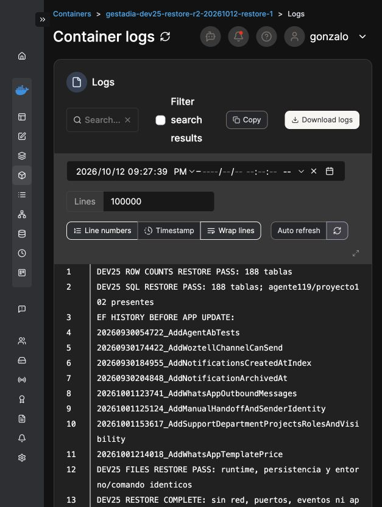

## Preparación independiente del despliegue QA, aún sin aplicación

Se verifica en el remoto la rama aislada `codex/app-dev25-qa-20261012` en `30be1692e5ba2c7bbb41a9603fcd07adab55bbe0` y la etiqueta rollback `rollback/app-dev25-qa-20261012` en `64ced36a9a7d98edf1936cb27814d6d822814279`. El diff de Program/compose/Dockerfile conserva arranque, seeders, puertos y volúmenes; añade registro APP/logger y un flag global APP apagado por defecto. Settings originales preservados privadamente: GitOps ON con mecanismo **Webhook**, Polling OFF, Re-pull y Force redeployment ON. No se guarda ningún ajuste ni se cambia referencia. Arquitectura real del contenedor 25 leída mediante `uname -m`: x86_64; el UID/GID mostrado corresponde al usuario explícito de exec, no acredita el usuario por defecto de la imagen.

La primera generación local del bundle EF falla durante descubrimiento del contexto porque tooling obtiene el proveedor del Host y ejecuta AutoDetect. No se atribuye a ese intento ausencia de Host ni se ejecuta en el servidor. LidIA prepara un startup de tooling separado: compila y `dotnet ef dbcontext info` funciona con factory offline y sin proveedor de aplicación. El producto 30be permanece intacto. El lector de versión de DB R1 devuelve inconcluso y se conserva; no se lo convierte en PASS ni se repite. La versión real se recupera de los comentarios del SQL original verificado: MariaDB 11.4.12. QA acepta esa procedencia; LidIA confirma en el exportador exacto que el encabezado procede de SHOW variables version/version_comment del servidor real. Lector R2 preparado, **sin ejecutar**.

Se genera el bundle oficial Linux x64 y se prepara su transporte privado mediante los controles de carga Docker de Portainer ya autenticados. Portadora limitada al archivo y manifiesto, copia a carpeta nueva de herramientas, sin montar SQL/entorno/configuración; gate previo de destino e historial y ejecución EF pendientes de revisión completa. No se carga aún ningún archivo ni se aplica migración, nuevo runtime, proyecto, clon o S2S en 25. La elección de la ficha de la llamada humana PRO sigue pendiente y es independiente de esta preparación QA.

## Selección humana recibida y migraciones DEV25 verificadas

El humano identifica el Contact de la consulta privada para su llamada. Esta selección no modifica la ficha ni reactiva permisos. LidIA prepara la asociación administrativa limitada a la cuenta y conversación, preservando los datos del Contact y el Lead independiente; quedan pendientes copia PRO y autorización concreta vigente antes de asociar y reservar.

Se importa una vez la portadora privada revisada; imagen real `sha256:2894a87a523168ba5e31961fa46ad7895000e73ead4efd1e55444e2b2fa2718d`. Preparación nativa PASS sin DB/HTTP/Host. Stack 124 copia el bundle oficial `65530bb1a160967141d468ae653d49216f51565f41ee5b3d723227de5caf1b6d` a la carpeta propia de herramientas; salida 0 y `DEV25_EF_CARRIER_COPY_SHA_PASS`.

Vista previa ejecutada una vez: destino DEV25, historial previo exacto de 257 migraciones y tres pendientes esperadas, APP apagada. JSON transcrito de pantalla y cotejado contra SHA del servidor `18b1a9fa6357ded580120812d4cd6f11281cdccc981cffce7d78e7d0727e334d`; no se atribuye recuperación directa de archivo. Apply oficial ejecutado una sola vez: `dev25_ef_migrations_verified`, historial posterior exacto de 260, tres migraciones APP aplicadas; `app_enabled=false`, `host_started=false`, `crm_http=false`. Marcador irreversible de ejecución preservado; no repetición. El runtime 25 todavía sigue en 64ced; comprobación de esquema y actualización de referencia siguientes, sin activación S2S ni CRM.

## Runtime DEV25 actualizado y nuevas copias PRO restauradas

Después de comprobar 198 tablas e historial 260, se guardan la referencia QA congelada y `AppConversations__Enabled=false`. Los 57 valores de entorno anteriores se cotejan idénticos; GitOps Webhook, su enlace, Polling OFF, Re-pull y Force se conservan. Un único Pull/Update devuelve 504 en el navegador; no se repite. Reconciliación posterior confirma fuente 30be1692e y nuevo contenedor 462d0014305650331705c5352eb7ee177377fa9190dace6630ba536d71971b69 sano. Lectura nativa posterior PASS: V1.728-app-diagnostico, DB DEV correcta, 198 tablas, historial 260, configuración APP ausente y flag false. Se inspecciona 119 mediante SELECT de metadatos y hashes; se recuperan informes originales sin repetir consultas. Ningún clon ni integración QA activados. El acceso normal del operador por /admin/chats muestra el login y luego la DB DEV; la correlación completa con el proxy sigue pendiente de cotejo.

Antes de asociar el Contact elegido se crean copias PRO nuevas. Portal: SQL 302.759 bytes, SHA256 7a3db943d2dc0fb7e5d05da7e1315bea86e91f9732683537739081e3072ef60a; servicios de copia stack 125 salen 0. Restauración aislada stack 126: recuentos 45/94/14/15 coinciden, comprobación SQL PASS y configuración/claves/documentos idénticos; ambos servicios salen 0. Los recuentos se observaron tras el dump y no se les atribuye una vista transaccional conjunta.

LidIA: copia manual nueva, archivada con runtime/configuración/entorno/comando privados; SQL SHA256 d7be7176290a83ea9f07c0c86a05a8bc8fecb9135c822c65dfc9b34b828503e5. Manifiesto original recuperado por lector RO sin red, stack 127 salida 0, SHA256 c16d47c9421e9f801100c2ca2412efddf908c4269ef968ba5342122552ea04cd. La DLL PRO real es 3ba869b673f26cede7c3f5a14e36505ba7a4e8b35b14d66b04e57fc9ef018d07. Fixture revisado SHA256 81360e27437f1e7648a7bc5ff8b1030d3623f0cc6b4b3714d135a89499f78d50, ejecutado una vez en stack 128 aislado: 198 tablas comprobadas, vínculo de la misma cuenta/sesión presente, 21 mensajes externos APP y 0 ChatLogs externos observados en la copia; runtime y configuración/entorno/comando coinciden. Resultado LIDIA RESTORE PASS y salida 0. Estos recuentos son baseline restaurado, sin atribuir contraste live.

El paquete administrativo del Contact continúa en revisión y preflight; no se ha instalado autorización ni escrito el campo CRM. La resolución del producto y el creador de Calls preservan Name/Email/Phone del Contact propio, según revisión del código por LidIA. Siguen pendientes aprobación concreta nueva, asociación, reserva real, recibo durable y retirada de permisos.

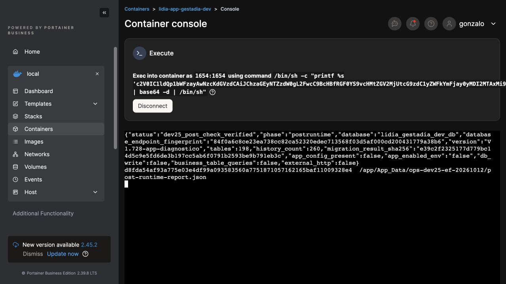

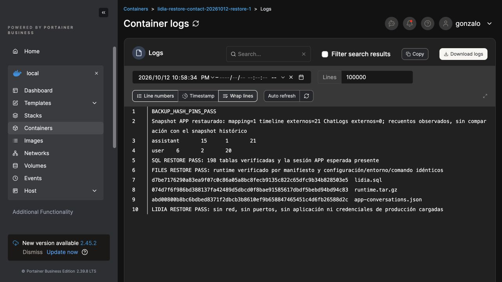

## Preparación de asociación y nueva autorización pendiente

R2 administrativo del contacto: 51 comprobaciones offline, paquete Source revisado y tres payloads cotejados con publish. Instalación privada en carpeta nueva persistente, runtime/configuración/dependencias verificados, sin autorización instalada. Preflight real en PRO PASS, cuatro Save bloqueados y cero DB/HTTP. El guard de identidad conserva continuidad Guest→account mediante el propietario de la misma conversación y no atribuye propiedad por teléfono.

La lectura administrativa inicial informa token caducado. Se prepara y revisa mantenimiento nativo de conexión 4 mediante GetAccessTokenAsync: 21 comprobaciones offline, transporte y restricciones verificados, preflight real PASS. Antes de renovar, preview RO observa token ya vigente hasta 22:36:57 UTC, cero POST y cero Save. Root **no ejecuta renew ni crea su marcador**; no atribuye esa renovación a sus acciones. R2 comprueba nuevamente token válido sin Contact/HTTP/salida de tokens/escrituras. La correlación del Contact sigue sin modificar y no existen permisos temporales ni aprobación administrativa activos.

Se formula una única autorización humana nueva al acto: dejar guardado el vínculo de la ficha elegida con la cuenta, preservar datos y Lead independiente, habilitar una hora sólo para cuenta/conversación y reservar la llamada informativa del 13/10 a las 10:00 Madrid; retirar permisos al terminar y conservar únicamente correlación. Respuesta todavía pendiente. La reserva no se acreditará sin Call real, recibo durable y reapertura de la misma sesión.

## Lectura independiente PRO119 R2 inconclusa

Mientras se espera la respuesta humana se revisa y ejecuta una sola lectura privada del agente 119 real de PRO para resolver la diferencia observada con DEV. Fuente y paquete preparados por LidIA/QA: script 0590471af8f1a1ed64e7acfabb3b5432edbe8757346853f401c163a56ac26c07, transporte b9b282d389cd767df2278c0485b4f00695e34c88da60e864d49976b37787d260, DLL 789db848506d4981807dab3bb64394faa2661b3dfb90d84a7532481219f1508a; tres archivos de tar cotejados contra publish. Restricciones revisadas: tablas funcionales permitidas, cuatro Save bloqueados, transacción RO sin locks, runtime/configuración inicial/final y prompt previstos, sin Contact/chat/credenciales/HTTP/Host/import. La huella inicial de endpoint DB no está fijada; sólo se plantea observarla, sin atribuir comprobación previa.

Resultado real: pro119_export_inconclusive, System.Text.Json.JsonReaderException; db_write=false y snapshot_content_printed=false. Se preservan marcador, carpeta y captura; no se repite la ejecución ni se acredita snapshot/importación a partir de esta salida. LidIA revisará el formato con diagnóstico de etapa seguro. La lectura inconclusa de QA es independiente de la llamada: preparación de Contact y permisos siguen cerrados, respuesta humana pendiente.

### Formato del archivo servido corroborado

Se ejecuta una lectura administrativa mínima de appsettings.json: pins de DLL PRO y configuración APP originales PASS; sólo tamaño, SHA256 y primeros tres bytes, sin valores ni DB/HTTP. Resultado servido: 4.563 bytes, SHA256 8b090f7dc91022419a4301a190de857c96a4a9d1e889f10c33e4a7d02d8ae11a, cabecera EF BB BF (BOM UTF8), idéntico al candidato local. LidIA conserva prueba RED donde el proveedor JSON nativo acepta ese BOM y el Parse(bytes) del exportador produce JsonReaderException; prepara una revisión independiente del lector. No se modifica el archivo de configuración ni se repite R2.

## Lectura PRO119 R3 con parser corregido y pin de prompt no coincidente

R3 se prepara en carpeta independiente, conservando R2: StreamReader con detección BOM, SHA de bytes originales, lectura de configuración antes de abrir DB y diagnóstico limitado a fases/posiciones sin contenido. Fuente revisada por ambos equipos, 74 comprobaciones offline y preflight PASS; Root coteja transporte, tres archivos del payload con publish y shell. Script 3193a6952820f01b5ae4fb8dee6c52303c322acf51d7ead2714e547dcf7403e4, transporte d53b13b7f771fee692db399370a4d7d2056b95da6d5280a70470990af68d86aa, DLL f8f725475d7eb799ad892496661796e194fb17adef0cf36df050a14b7f92ab4f.

Una ejecución real R3 supera el parseo y se detiene en verify_prompt_pin con pro119_prompt_pin_mismatch. No escribe DB ni imprime contenido; tampoco acredita snapshot o importación. No se cambia el pin automáticamente ni el agente para hacer coincidir una referencia histórica. Se solicita observación mínima del 119 actual —identificadores funcionales, versión y SHA/longitud del contenido— para determinar la diferencia antes de revisar la siguiente acción. La cuenta/conversación de la llamada siguen sin permisos nuevos ni reserva, a la espera de la confirmación humana.

## Metadatos actuales PRO119/122 verificados (13/10 Madrid)

Inspector independiente ejecutado una vez a las 22:21:25 UTC del 12/10 (13/10 local), con tres SELECT de metadatos, transacción RO y cuatro Save bloqueados. Runtime y configuración inicial/final coinciden; no consultas de contactos, chats o credenciales, HTTP, Host ni escrituras DB. Agentes actuales 119 y 122 apuntan a instrucciones diferentes (10115/10116), pero ambas tienen Version raw `1.8-mario-adaptado`, longitud 65.532 caracteres y Content SHA256 `ec616c2687189eaded1a77d904d2c720aa12c8ab9f629850f74bc4202bcd0286`. La interfaz añade el prefijo `v`; el pin literal de versión del exportador R3 era incorrecto. El hash de contenido coincide con el pin histórico. Esto verifica estos tres atributos, sin acreditar equivalencia funcional completa.

Informe original recuperado sin repetir SELECT mediante lector aislado stack 131; bytes decodificados y SHA cotejado contra sha256sum del servidor: `3135a1be571bb7c5e431f18f55d2a308312420665ffc2d96d1a5c69a5e9a81a7`. Dos transcripciones iniciales de pantalla se corrigieron al cotejar los bytes originales; sólo esta huella y el archivo privado verificado son la referencia. R2/R3 y sus marcadores permanecen intactos. No se ejecuta todavía nuevo exportador ni importación DEV. La asociación del contacto, permisos temporales y reserva siguen pendientes de la respuesta humana a la autorización ya formulada.

## Exportación original PRO119 R4 completada en lectura

R4 independiente conserva el hash de contenido histórico y corrige sólo la versión literal observada, añadiendo la huella del endpoint DB antes de SELECT y la referencia al informe original. Paquete revisado por LidIA/QA y Root: 78 comprobaciones y preflight, transporte/payload de tres archivos/publish/shell cotejados. Transporte SHA256 4f1d1de3ac22b9edec24ed09a3e3b44b713fc2bff5e6357ede3e44bfa9bdf28b; script 65ae0ae932d5ab270c985f44a1ee75dbd9317998015d9d88b01473efcb131d01; DLL 0611fdd4ec7b5b1af0fa030c730d15bf7da86dfd891b0cc17b79bb7636d35e8d. Una ejecución real a las 22:32:43 UTC del 12/10 (13/10 Madrid): pro119_private_export_complete_read_only; sin escrituras DB, HTTP, Host, nuevas filas ni importación. Originales y marcadores R2/R3/inspector preservados.

Reporte original 2.600 bytes SHA256 3344fca2ea6961818667bdd6bcd76f8bf9cb43888ad5e465b19307d8ffa3083b recuperado por lector RO stack 132, salida 0, cotejado con sha256sum servidor. Snapshot funcional privado 103.806 bytes SHA256 b5ea5b60cf925844210a77409b6ecd811faa8f39f195579683554954c8893d34 recuperado completo por stack 133 sin red y sólo lectura; permisos 600, SHA esperado comprobado antes de transferir y bytes completos cotejados localmente. No se repite ninguna consulta o exportación. Archivos fuera de Git, compartidos por ruta privada con los equipos autorizados para revisión.

Se observan ocho herramientas explícitas, cero candidatas globales y cero flags pendientes en la configuración. El reporte conserva los límites de cache del proceso, destino real del alias del proveedor, generación enviada y personalidad en cache; no se acredita comportamiento servido sólo con este snapshot. No se importa en DEV ni se activa S2S/CRM. La cuenta/conversación/contacto de la llamada siguen sin nueva asociación, permisos ni reserva hasta la respuesta humana pendiente.
