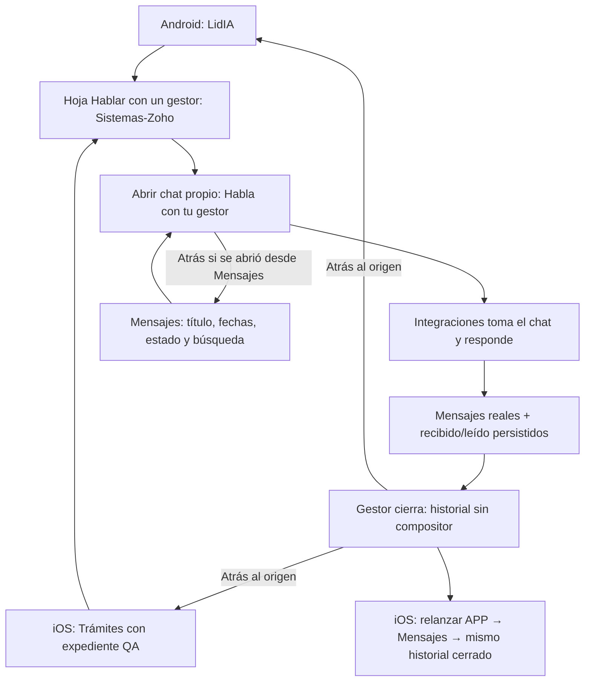
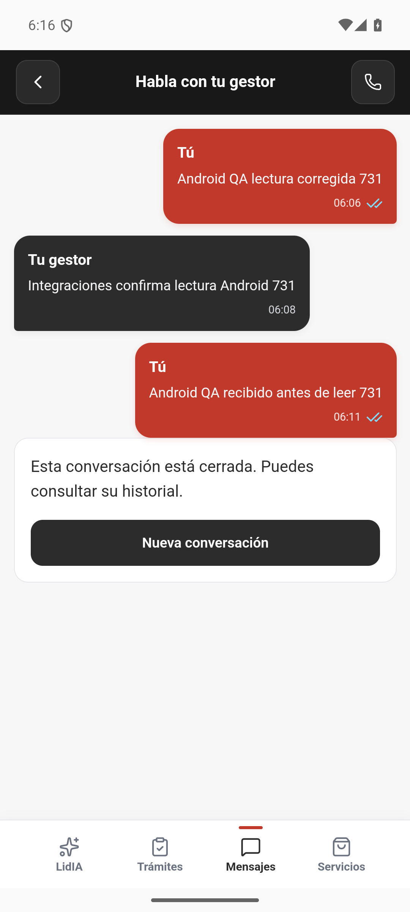
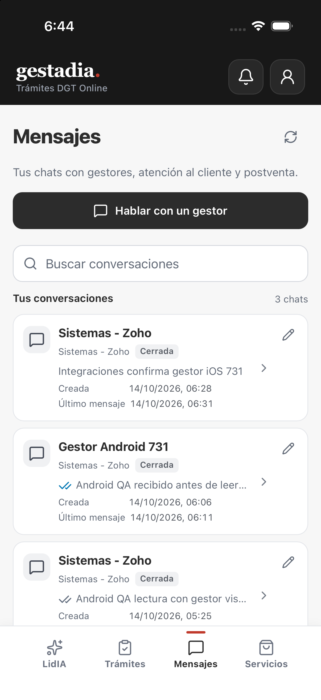
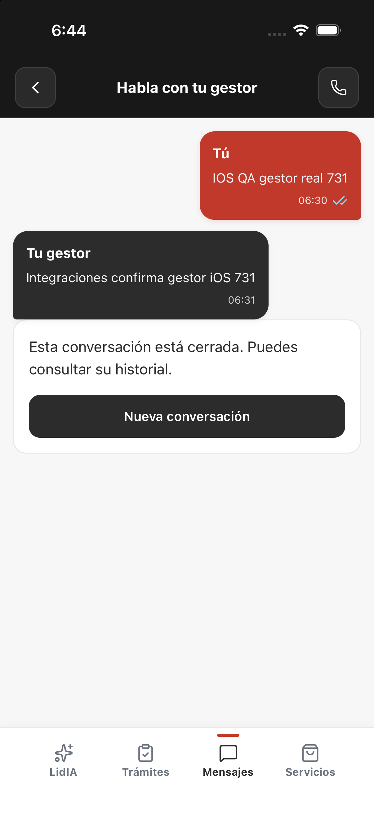

# Gestor real en Android e iOS · 14/10/2026

El intercambio con Integraciones, los recibos de recepción/lectura en ambos sentidos y el cierre están comprobados en los dos emuladores. iOS también recupera su historial cerrado después de terminar y relanzar la APP. [Revisión saneada](manager-native-window3-review.json) · [Matriz](README.md).

## Fuente, alcance y corrección

Los paquetes source27 conservan el producto `c6530f6a20a134feb96de7bb15b9f89ee4af6975`: iOS0.1.0(11), Android0.1.0(4), API privada3005 y cuenta/caso propios. La comparación actual de backend/frontend/shared/scripts contra ese producto no contiene cambios. No se atribuye a estos paquetes otra versión pública del backend.

El receptor DEV sirve `6106a8a1e5a14acbb7bf056a0461e543d5b734bd`, V1.731-recibos-app-window. Ops verifica DLL9e90e4c1, módulo JS4874cadf y contenedorc107f53f; Source confirma el módulo cargado normalmente en su panel. El fallo anterior Illegal invocation se corrige ligando getComputedStyle al Window real. Portal ejecutó independientemente las diez pruebas específicas; los resultados y el error anterior se conservan.

La ventana04:00–05:00UTC mantiene los recursos de atención anteriores: proyecto104/agente124, Integraciones, departamento/ruta propios, seis claves y los tres permisos de expediente. Sólo cambian sus dos fechas. CRM, guest, callbacks y v2 no se habilitan. El GET firmado de preparación04:03:56 devuelve404conversation_not_found sin crear conversación ni turno. La relación Contact–Deal–Owner ya comprobada se conserva; en esta ventana no se crean registros CRM, pagos ni Cerrado ganado.

## Recorrido visible comprobado

El nombre Sistemas-Zoho es el propietario resuelto desde CRM; Integraciones es el operador que atiende. No se altera el propietario del trato para simular esa asignación. Ninguna reapertura crea otra sesión ni pulsa Nueva conversación.

### Android

La conversaciónb308 contiene tres mensajes reales: dos del cliente y una respuesta de Integraciones. Se observa Recibido antes de Leído para el segundo mensaje del cliente. Source lo mantiene fuera del área visible del historial y, al desplazarlo al área visible, persiste su lectura. Los tres mensajes tienen recepción/lectura y actores correctos en la lectura primaria04:14:57UTC.

La variante de documento oculto no queda acreditada: el navegador devolvió visibilityState visible en ambas pestañas. No se falsifica ese estado; la comprobación válida es fuera/dentro del área visible del historial.

Renombrar guarda `Gestor Android 731`, la búsqueda731 lo encuentra y se conservan creación/último mensaje/estado. Atrás vuelve a LidIA o Mensajes según origen. Después del cierre se reabre el historial completo, con dos ticks azules y sin compositor. Tras force-stop/relaunch se comprueban cuenta y lista, título, fechas, Cerrada y preview leído. La automatización posterior se detiene antes de abrir la fila, por comprobar demasiado pronto la carga: **no acredita el historial completo Android después del reinicio**. Se conserva el intento original y se corrige la comunicación anterior que lo daba por terminado. Los tres mensajes sí se recuperan completos desde iOS.

### iOS

Se recupera primero el historial cerrado Android y se vuelve a Mensajes. Trámites abre la hoja del gestor y una nueva sesión59c8. El teclado capturado de Device Hub introduce el mensaje; se desactiva la captura antes de operar el panel de Integraciones. La APP muestra `IOS QA gestor real 731` y la respuesta `Integraciones confirma gestor iOS 731`. Los textos, recepción/lectura y actores se conservan en el original privado Source04:33:45UTC, cotejado por SHA.

El gestor cierra la conversación y desaparece el compositor. Atrás lleva a Trámites, su origen. Terminar y relanzar conserva la cuenta; Mensajes muestra las tres conversaciones, fechas/estado y preview. Abrir la primera fila recupera los dos textos, el tick azul y el estado cerrado, sin compositor. Capturas posteriores al relanzamiento:

## Retirada y límites

Los simuladores propios quedan apagados conservando sus datos. Portal detiene su API activa antes de retirar el grant mediante el servicio estándar. Tres POST de contexto reciben200/persisted con permisos efectivos vacíos a las04:45:00UTC: revisiones4/2/2, todas las conversaciones cerradas, cinco operaciones de turno sin cambios y ninguna pendiente. El último deadline de propagación es04:46:00.301UTC. Ambos scopes locales se guardan apagados y la API reinicia sin proveedores ni worker externos. La lectura efectiva primaria de Source y la retirada CAS del perfil/ENV del receptor tienen sus comprobaciones posteriores separadas; los ACK no las sustituyen.

La lectura primaria posterior de Source04:47:02.335UTC confirma los tres contextos4/2/2 con permisos vacíos, mensajes3/3/2 y cero operaciones pendientes. El original SHA f300a25b se coteja directamente; usa READONLY y termina rollback/cierre. La identidad del certificado sigue sin acreditarse. Source informa también reapertura operativa real desde Sesiones con los historiales propios, sin mezcla; eso se atribuye a su inspección. Portal verifica otra vez a las04:49:30: grants vacíos, tres chats cerrados y sincronizados, pendientes0, scopes/proveedores/worker apagados.

Ops completa la retirada CAS del perfil1c7 y recrea una vez DEV con su configuración original. La captura real04:54:57UTC muestra APP_ENVfalse, PROFILE_ABSENT, DLL9e90e4c1, JS4874cadf y HTTPS200 en el contenedor74722a88. Su revisión confirma58variables sin diferencias y conserva el backup del perfil; Portal coteja el SHA549182c7 de esa revisión y el hash de la captura. [Revisión Ops íntegra](manager-window3-dev-off-ops-review.json) · [Captura real](manager-window3-dev-off-actual.png). La revisión procede de la lectura visible de Portainer; no se presenta como JSON original emitido por el servidor. Los cuatro flags del recurso importado y todos los historiales permanecen, por lo que no se afirma restauración total de DEV.

La [PR17](https://github.com/enmarkados/Gestadia_Portal/pull/17) se fusiona en app/main a las04:52:49UTC mediante395deaa8. El checkout principal y el de QA quedan limpios y sincronizados con remoto0/0. Backend/frontend/shared/scripts/deploy siguen sin diferencias frente al producto c653 probado. El simulador iPhone17 original, cerrado temporalmente con autorización humana, vuelve a Booted a las04:56:51 sin lanzar ni modificar LIA; los emuladores de QA propios permanecen apagados.

El [preflight de Portal](portal-runtime-preflight-ops-review.json) confirma en lectura de terminal Ops las15migraciones terminadas y sin rollback, incluidas app_callback_scope y app_profile_context, y las cuatro columnas previstas. Compara cuatro archivos del backend servido —contact, configuración, schemaPrisma y ruta de contacto— con c653; Portal coteja sus cuatro hashes y el inventario de migraciones contra el checkout actual. La revisión íntegra SHA6be0861c conserva su procedencia de UI, sin presentarla como JSON original SQL. El frontend público también identifica c653. No se aplica migración, no se escribe en la base y no se redespliega Portal por la fusión documental; la actualización del receptor LidIA en producción tiene su entrega separada.

No se borran la cuenta, el expediente, Contact/Deal ni los ocho mensajes de atención. El chat anterior conserva el fallo histórico de lectura. Tampoco se atribuye a esta ronda aceptación guest, cualificación estructurada, callback, OAuth, push o instalación física. iGonchu aparece unavailable en el preflight04:45; la instalación requiere que ese dispositivo concreto vuelva a estar conectado. El iPhone de Juan disponible es ajeno y no se utiliza.
