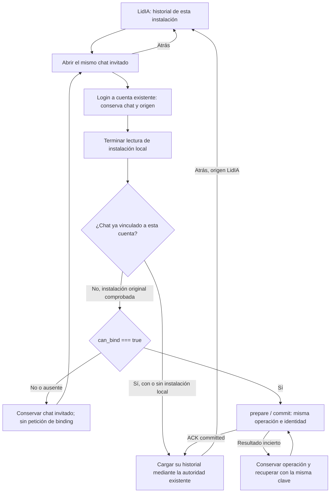

# Chat invitado y login: corrección local del consumidor

14/10/2026. Rama `codex/app-guest-binding-guard-20261014`, base8725fc0. Corrección local dentro del encargo humano de arreglar «Continuar sin registro», coordinada con Source/Ops. No es aceptación del receptor guest ni autorización de activación. [Plan](../../../superpowers/plans/2026-10-14-app-guest-consumidor-limitado.md) · [Mapa](../../NAVEGACION.md) · [Manual](../../MANUAL-DESARROLLO.md) · [Glosario](../../../../GLOSARIO.md).

## Qué cambia

El login conserva el chat invitado cuando el consumidor no tiene las dos capacidades de vinculación preparadas. `can_bind` es una propiedad de la respuesta local Portal: por defecto false, también cuando faltan claves, su ID/base64/longitud no son válidos, no hay sesión remota preparada o el chat ya tiene propietario. No acredita permisos efectivos en LidIA ni un ACK de vinculación. No se añade al DTO S2S.

El backend comprueba identidad y propiedad antes del guard; si no dispone de binding, devuelve503 `runtime_unavailable` sin crear `AppGuestBinding`, cambiar propietario/revisión o emitir una petición de binding. Conserva una operación incierta ya existente. Con capacidades restauradas recupera el mismo ID, DTO y clave de prepare, después commit; la propiedad sólo cambia tras ACK. Un vínculo ya completado sigue siendo idempotente aunque las claves se retiren.

La pantalla autobindea sólo con `can_bind === true`. Espera a terminar la lectura de la instalación al montar tras login: `undefined` significa pendiente y `null` ausencia comprobada. Una cuenta con un chat ya vinculado puede leerlo desde otro dispositivo sin crear instalación, chat o binding. La ausencia de capacidad mantiene el historial del invitado en su dispositivo, sin anunciar guardado en cuenta ni continuidad entre dispositivos.

## Pantalla, estado y navegación

No hay componentes visuales, textos, rutas ni permisos nuevos. Se conservan cabecera, compositor, origen y Atrás del chat. Las capturas vigentes siguen representando sus elementos; el cambio es la decisión de carga/vinculación. No se presenta una captura de datos simulados como prueba del receptor conectado.

## Regresiones y ejecución

- Baseline del servicio:10/10 sobre Prisma/MySQL real local descartable.
- RED backend:11 pasan y9 fallan. Fallos observados: `can_bind` ausente y falta de rechazo antes de un binding no disponible. No fueron errores de importación/conexión.
- GREEN backend dirigido:20/20; cubre claves ausentes/inválidas, propiedad ajena, ausencia de cambios locales/HTTP de binding, lectura invitada, prepare perdido y recuperación, cuenta-only y vínculo idempotente.
- RED frontend inicial: el caso con capacidad explícita no llamaba binding por la carrera de instalación. Corregida la espera, los tres casos false/ausente/string mostraron `runtime_unavailable` y perdieron historial. Tras la condición estricta pasan. Otro RED mostró el loader indefinido de cuenta sin instalación; se diferencia pendiente de ausencia y se recupera su historial. También se prueba instalación diferida sin adelantar list/bind/timeline.
- Suite backend completa:365/365, cero fallos/cancelados/omitidos. Comando `npm test --prefix backend`, con entorno aislado.
- La primera suite frontend sin límite de workers falló211/212 en `PluginWebContext.test.jsx > recupera una respuesta humana tras un 504 sin reenviar y conserva la sesión al abrir Gestor`: no apareció «Comenzar conversación» antes de la espera. PluginWeb pasa5/5 en la ejecución separada, sin cambiar su código, sus pruebas ni los timeouts. Una repetición completa con dos workers pasa213/213; la última ejecución tras añadir el caso de instalación diferida pasa214/214 en49 archivos.
- Frontend conserva tres diagnósticos JSDOM `Not implemented: navigation (except hash changes)` originados en `CheckoutForm.jsx:82`; no se ocultaron ni se modificó ese flujo. El resultado de tests se declara aparte de estos mensajes de stderr.
- `npm run app:build`: salida0; sólo assets web locales, sin sincronizar Capacitor, compilar nativo, instalar, reservar versión o subir binarios.

El [recibo de verificación](verification.json) contiene hashes y resultados finales. Los logs completos y credenciales de prueba quedan privados.

## Aislamiento y limpieza

`docker info` no respondió dentro de8s. No se reinició Docker ni se cerraron procesos ajenos. Se utilizó el MySQL local ya existente en127.0.0.1:59094 y un schema `gestadia_app_test` que se comprobó ausente antes de crearlo. Propiedad registrada con nonce privado; URL local comprobada por el harness y por el propio test del servicio. No se utilizó la base durable ni producción.

El primer `prisma migrate deploy` devolvióP3005 porque la tabla de control hacía el schema no vacío. Tras comprobar que esa tabla era el único objeto y pertenecía a la prueba, se retiró sólo ese marcador durante la aplicación de las15 migraciones del repositorio y se restituyó. El recibo distingue este intento fallido del despliegue de schema correcto. No se omitieron migraciones ni se baselinaron tablas de aplicación.

El runner privado elimina variables de integraciones/CRM del proceso hijo, apaga APP/v2/guest y usa fixtures con transporte remoto simulado. La suite mantiene los controles de nombre/host de la base descartable. Es una ejecución equivalente sobre el mismo schema y comandos del harness conversacional, **no** una ejecución exitosa del script Docker. Al acabar se verificó el nonce y se eliminó exclusivamente ese schema propio; el recibo registra el cierre confirmado.

## Límites de entrega

Sin push/merge funcional, recursos/claves nuevos, migración nueva, cambios de flags, despliegue, turnos reales, CRM o builds nativas. El Portal público y la app0.1.0(11) instalada no incluyen este delta. El perfil guest público permanece en el estado OFF de la última comprobación Ops; no se vuelve a activarlo por estas pruebas. Siguen pendientes receptor/candidato revisados, capacidades y revocación reales, piloto nativo conectado y compatibilidad/continuidad para la salida pública según el plan.

## Entrega para revisión

Después de la verificación local registrada en `verification.json`, se conserva el commit funcional752420dd565a4a89b5350cdf05c573ee671e42ef y se sube únicamente la rama revisada en la [PR18 borrador contra app/main](https://github.com/enmarkados/Gestadia_Portal/pull/18). Source y Ops revisaron estáticamente el delta, incluido el estado undefined/null, sin P1/P2 pendientes; sus revisiones no se presentan como ejecuciones independientes de las suites. El recibo anterior conserva su momento previo al push; esta sección actualiza la entrega. No hay merge, despliegue, activación guest o binario nuevo.
