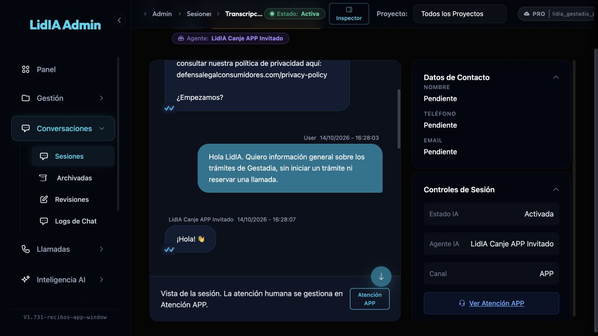

# Cuenta de revisión Apple y Google Play · 14/10/2026

**Estado vigente:** cuenta creada y login validado; continuidad web y recuperación por cuenta comprobadas; credenciales guardadas en Apple y Play. iOS1.0(12) procesado «Lista para enviar»; asignación QA pendiente de autenticación. Android1.0(5) disponible para testers internos. Aceptación guest nativa, documentos con expediente propio y publicación pública no acreditados. Los apartados siguientes conservan el avance y límites de cada recibo.

La instrucción humana autoriza crear una cuenta estable para que Apple y Google Play puedan revisar la APP. El identificador administrado es `app-review@gestadia.com`. Su contraseña se conserva en el archivo privado de credenciales, modo600, y no se incorpora a Git. La cuenta no crea un buzón ni representa una compra o cliente de producción.

Operaciones comunicó una única ejecución administrativa por Plesk usando `consumeAccountProof` y la invitación normal del backend. Cuenta `75d32ddc-2a72-4db5-af5f-0565ad0e30f2`, método `invitation`, verificada el14/10/2026 a las15:43:09.029 de Madrid (13:43:09.029Z). Estado informado: cero expedientes y grants explícitos, sin CRM ni Stripe. No se modifica la política de sesiones ni se usa una identidad temporal de24h.

El login real en Chrome alcanzó el inicio con cero chats; captura comunicada `reviewer-login-home-actual.png`. Root cotejó sólo que el principal del archivo privado coincide con el alta. El login y la captura se atribuyen a Operaciones; no se repitió el acceso desde este hilo. El recibo privado conserva esa procedencia y no contiene la contraseña.

Pendientes: despliegue del arreglo PR22, primer turno real, login de esta cuenta en la instalación invitada original y ACK de vinculación que conserve la misma conversación/timeline. La conversación existente no se recrea. Permisos conversacionales proceden de su vínculo autorizado; no se conceden privilegios administrativos o CRM por esta cuenta. La entrada autenticada posterior y la funcionalidad disponible para el revisor deben comprobarse antes de afirmar acceso completo.

La MISMA cuenta se entregará por los formularios de App Review y Play App Access con instrucciones del recorrido realmente verificado. Esta evidencia no acredita aún ese guardado, subida de binarios, revisión, publicación ni disponibilidad en tiendas.

## Comprobación focal de interfaz de la cuenta

Operaciones ejecutó una única navegación de lectura por cada vista con la cuenta de revisión:

| Vista | Resultado comunicado | Límite |
| --- | --- | --- |
| Trámites | Abre «Mis trámites / Aún no tienes trámites activos» | Sin expediente propio; documentos no evaluados |
| Mensajes | Abre lista con cero chats y botón «Hablar con un gestor» | No solicita llamada ni crea conversación |
| Mi Perfil | Identidad Revisión Tiendas, clasificación Lead, datos personales, Guardar, restablecer contraseña, solicitud de borrado y enlaces legales | No guarda cambios, restablece contraseña ni solicita borrado |

No se mostró denegación ni403 en estas tres vistas. Los estados vacíos no equivalen a falta de permisos. La inspección focal de `currentAccess` confirma que una conversación propia sin caso y sin grant dispone por defecto de history y sondeo para purpose sondeo, bajo el filtro de permisos del entorno; no acredita una respuesta real de LidIA. No se añadieron grants, expedientes, pagos, asignaciones ni CRM. La vista web no acredita la funcionalidad push nativa.

Acceso completo para las tiendas sigue pendiente: faltan el ciclo real LidIA/continuidad y la evaluación de documentos de un expediente propio. No se marca la declaración de acceso completo a funciones/contenido premium únicamente por haber abierto estas pantallas. La decisión humana rechaza instalar SSH nuevo; Operaciones conserva Plesk/Portainer y no instaló la clave.

## Primer turno real en la conversación original

Operaciones comunica despliegue Git del backend3b95062/app/main7e3a9b4, stack162 saludable, y una respuesta real visible con HTTP200 al nuevo turno5e73e6b3, conservando conversación085abe94 e instalación. El intento400 anterior no se presenta como el mismo mensaje admitido. [Recibo con IDs, procedencia y límites](guest-real-turn-ops-reported.json). No hubo acción CRM ni reserva.

El login de la cuenta de revisión ya se ejecutó en esa instalación invitada; ACK binding committed e historial idéntico posterior siguen sin confirmar. No se recreó el chat ni se enviaron turnos desde este hilo. La atribución al agente/proveedor y las pruebas nativas conservan sus propios requisitos de evidencia. Este avance tampoco acredita documentos ni el checkbox de acceso completo de las tiendas.

## Continuidad web y vínculo durable comprobados

Actualización posterior comunicada por Operaciones: la lectura primaria de Portal devuelve propietario reviewer, access_revision2 y binding committed; el ACK también es committed/2 y conserva el mismo remoteConversationId. La instalación original muestra el mismo historial y otra sesión Chrome de la cuenta, sin instalación guest, recupera un chat: la misma085abe94. [Recibo con procedencia y límites](guest-binding-ops-reported.json).

El recorrido web guest → respuesta real → login → vínculo → recuperación por cuenta queda comprobado por Operaciones. No requirió otro cambio de código, grant o expediente. Los apartados anteriores conservan el estado que tenían antes de este recibo. Siguen pendientes la atribución de runtime/proveedor por Source, la aceptación guest nativa, la retirada individual acordada y la evaluación/entrega de acceso completo de tiendas; no se presentan como resueltos por este ciclo web.

## Apertura normal en Sesiones de LidIA

Source abrió una única vez la fila existente desde Sesiones y su detalle. La ruta observada conserva remotecc495e35; listado con siete mensajes y detalle con bienvenida, consulta informativa y respuesta. La captura, inspeccionada por Root, muestra canal APP, agente «LidIA Canje APP Invitado», IA activada, PRO y marcadorV1.731-recibos-app-window; nombre/teléfono/email siguen pendientes. [Recibo y límites](lidia-session-ui-source-reported.json). No se infieren el UUID interno de BD, IDs numéricos de proyecto/agente ni proveedor/modelo que no muestra esta superficie.

Incidencia concreta visible: la bienvenida enlaza la política de privacidad de defensalegalconsumidores.com. Se ha remitido a Source para contrastarla con la referencia usada por la APP; la captura histórica se conserva sin editar. La diferencia de dominio no acredita invalidez de la política, propiedad del contenido ni autorización para cambiar el prompt. Esto no invalida el vínculo/historial comprobado.

Referencia implementada de privacidad: LegalLinks declara /legal/privacy y LegalPage muestra connectedLegalDocuments.privacy en shared/legal-content.js. Con el origen APP corresponde a https://app.gestadia.com/#/legal/privacy; es una ruta de navegación, no evidencia de aprobación jurídica de una URL externa para la bienvenida del agente. No se ha localizado esa aprobación documental en esta comprobación acotada.

## Límite de retirada tras el vínculo

Source precisa que la revocación administrativa v2 comprueba OwnerActor antes de escribir. La085 está vinculada y su propietario vigente es la cuenta reviewer: no corresponde ejecutar scope guest con el actor invitado anterior, usar scope account como sustituto ni revertir el vínculo para fabricar un ACK. Logout tampoco es una revocación de subject. La cuenta y su conversación se conservan.

La pérdida de autoridad del actor guest tras binding y la continuidad por cuenta pertenecen al recorrido comprobado; una retirada administrativa de subject todavía guest con ACK/lectura primaria es una comprobación distinta. Sólo se ejecutaría con un subject propio no vinculado ya disponible y los controles existentes. No se ha identificado uno para esta ejecución ni se crea otra sesión/fixture/turno por rutina. El ACK administrativo guest permanece pendiente y no se deduce del ACK binding committed.

## Cierre del recorrido web y entrega de acceso a las tiendas

Operaciones comunica que el antiguo invitado, después de logout, tiene lista de chats vacía y no puede abrir085; el historial se conserva. Es pérdida de autoridad tras el vínculo, no ACK de hard revocation independiente. La misma cuenta de revisión se guardó en Apple y Play; Play muestra «Cambio guardado». [Recibo final comunicado](store-access-and-former-guest-ops-reported.json). No se repiten login, consulta, envío ni alta.

El producto no tiene contenido premium digital identificado en este recorrido. No hubo una restricción de rol observable y los estados vacíos no motivaron grants o casos artificiales. El acceso a documentos con un expediente propio no se ejercitó: la entrega de credenciales no acredita esa prueba ni todas las funciones nativas.

iOS1.0(12), subido una sola vez desde el archivo firmado existente, aparece procesado y «Lista para enviar», según Operaciones. Apple solicita autenticación al asignar QA. No hay recibo aquí de publicación, disponibilidad pública o aceptación guest nativa; tampoco se deduce una subida Android5 de haber guardado Play App Access.

Actualización Android posterior: [AAB1.0(5) subido una sola vez y disponible en pruebas internas](../2026-10-14-publicacion-1.0/android-internal-5-ops-reported.json), comunicado por Operaciones. La nota anterior de falta de recibo Android queda superada por este recibo; los límites de aceptación guest nativa y publicación pública se mantienen. Source incorporó su cierre documental mediante PR1721/dev/IA/main, commitc8d77dcef, sin repetir modelo/SQL/reservas.
