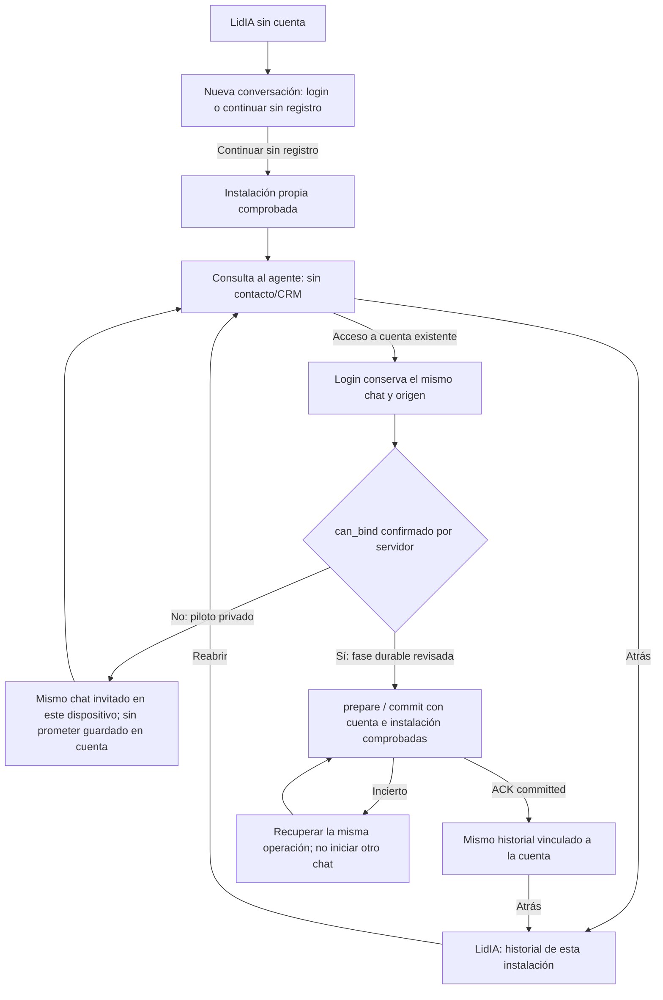

# APP sin registro: plan de contraste y consumidor limitado

> Para ejecución futura: usar superpowers:executing-plans, tarea por tarea. Este documento y la conformidad técnica no autorizan código, recursos, claves, despliegue o activación nuevos. Revisión conjunta Portal/Source/Ops antes de cada paso material.

**Goal:** preparar una consulta invitada real y aislada sin que el login provoque un binding no disponible, conservando la continuidad a cuenta aprobada para la salida pública.

**Architecture:** reutilizar instalación, subject, actor, firma, operaciones y DTO del contrato v2. El piloto empleará un consumidor QA privado actualizado y el receptor propio revisado; el Portal público continúa OFF. El vínculo durable y la compatibilidad con clientes ya instalados son una segunda fase explícita, previa a la salida pública si no se aprueba otro control de versión.

**Tech Stack:** Node/Express/Prisma, React/Capacitor, AppS2SClientV2 y receptor LidIA731.

**Spec:** [acta Source recibida íntegra](../../integraciones/2026-10-14-acceso-invitado-app-receptor-v2-recibida.md), [manual](../../app/MANUAL-DESARROLLO.md), [navegación](../../app/NAVEGACION.md) y [glosario](../../../GLOSARIO.md). Copia recibida14/10 a05:23:54UTC,10352bytes/SHAcd621fd810fe781c728500c93df65e319a02e4dd5560cc93635b02a1cd34371d. Las conformidades posteriores de revocación se registran aquí sin reescribir esa copia.

## Restricciones globales

- APP exclusivamente; perfiles v1/Main, DEV OFF, CRM, gestores, rutas, agenda y checkout permanecen fuera de este piloto.
- Fuente de producto Portal c653; último binario físico0.1.0(11) instalado y abierto, **sin aceptación guest**. No existe todavía un binario del delta propuesto ni se ha reservado/subido otra build.
- Receptor propuesto gestadia-app-pro-guest con proyecto/agente/instrucción/función propios y sólo sondeo/history; IDs reales pendientes de los recibos Source. No heredar recursos o claves Main/119/DEV.
- Project.PersonalityId y el cierre del lector Source requieren revisión real; el paquete antiguo fijado a728 no se ejecuta ni se corrige sólo cambiando su pin. No forzar null ni copiar prompts para eludirlo.
- Instalación: token opaco32bytes, sólo hash en Portal,30días. Conversación atestada: máximo24h. No equiparar esos plazos ni renovar identidad silenciosamente.
- Secretos sólo mediante archivos privados del propietario; no valores de claves en Git, chat o logs. No migración nueva: existen las cuatro tablas guest.

## Diagnóstico actual y delta

Ops observa05:22:07UTC en el backend servido d703: enabled=false, guestEnabled=false, integración/base/audience sin configurar y rolesConfigured=[]. Lectura de la configuración efectiva sin HTTP, datos ni secretos; captura privada SHAeb829e5112847241ce5733e4fa5f96aa52d19c929ce7a090dd1fe179e75cbe7f. Ese apagado explica runtime_unavailable; no significa que el flujo ya funcione.

| Elemento | Hecho comprobado en c653 | Propuesta limitada, aún OFF |
| --- | --- | --- |
| Configuración | config.js117–124 enumera8roles | No completar8por rutina: preparar sólo las capabilities acordadas |
| Transporte | AppS2SClientV2.call valida la clave de la petición | SESSION/READ/TURN bastan para sesión, turnos, consulta y recibos; no dan binding/CRM |
| Retirada | El test existente permite subjects.revoke con guestEnabled=false | Añadir cuarta REVOCATION propia administrativa para retirar subjects concretos con ACK; no confundirlo con apagar todo el perfil |
| Login | AppConversation.jsx230 llama api.bind si invitado+instalación+cuenta+ready | Condicionar a can_bind===true, derivado del servidor; ausencia=false |
| Backend bind | Crea AppGuestBinding antes de detectar la clave ausente | Rechazar runtime_unavailable antes de crear Binding o emitir HTTP cuando falten capacidades |
| Clientes antiguos | La build11 no entiende can_bind y sigue intentando autobind | Piloto privado; no abrir al público el perfil limitado hasta resolver vínculo durable o un control de versión revisado |
| Proxy | common.conf.template66 ya enumera las rutas guest existentes | Sin endpoint/proxy nuevo ni acceso genérico a api, contexto, webhooks o uploads |

El GET de conversations y el POST de installations son rutas existentes; no existe un endpoint de availability que pueda usarse como si fuera un contrato publicado. No se ha ejecutado otra petición guest remota durante este diagnóstico.

## Recorrido propuesto para revisión

La fase limitada no sustituye silenciosamente el diseño aprobado de cuenta opcional y continuidad. No ofrece registro nuevo ni contacto comercial. La instrucción real conserva las preguntas; no se deduce un favorable del país o de texto. Las pantallas actuales y sus capturas siguen en el mapa del11/10; este diagrama es propuesta, sin nuevas pantallas implementadas.

## Foco de revisión

1. Login con un guest existente sin BINDING: conserva chat/origen y no crea Binding ni petición S2S.
2. Build11 frente a respuesta nueva: no habilitar públicamente una combinación que se atasque al acceder a cuenta.
3. Dos instalaciones o cuenta sin control de origen: no cruzar historial, actor ni propietario por email/teléfono.
4. Resultado desconocido y caducidad: misma key/operación, sin nueva sesión/turno ni ampliación del plazo.
5. Retirada individual frente a apagado global: ACK persistido y verificación posterior antes de retirar las claves que permiten el control.

## Tarea1: conformidad y candidato aplicable

**Archivos:** este plan, acta recibida, preparación Source de ProGuestLiteralClone/ProGuestConfigurationOverlay y manifiesto privado de candidato. **Interfaces:** consume el acta y el runtime731; produce un delta revisado con recibos reales, sin activarlo.

- [ ] Source corrige/revisa lifecycle del lector y ejecuta únicamente la lectura acotada cuando esté aprobada; entrega evidencia que permita decidir la personalidad y la copia literal. No reintenta la preview fallida ni amplía FK por inferencia.
- [ ] Acordar SESSION/READ/TURN y REVOCATION separada, con capabilities/propiedad/TTL verificables; el cursor es otro secreto propio. Receptor GuestV2 y transporte global deben seguir activos hasta terminar la retirada individual.
- [ ] Preparar fragmento consumidor privado inicialmente OFF: APP_V2_ENABLED/APP_V2_GUEST_ENABLED=false, integración/audience gestadia-app-pro-guest, baseHTTPS y cuatro roles acordados. La revisión comprueba metadata y no imprime secretos. No es instalable hasta tener IDs/recibos y conformidad material.
- [ ] Ops reserva el siguiente número libre en su registro antes de compilar un candidato consumidor; fija fuente, assets, API de QA y firma. No se asigna un número hipotético ni se publica/sube una build desde este plan.

## Tarea2: comportamiento de binding del consumidor

**Modificar después de revisión:** backend/src/app/v2/guest.js, frontend/app/src/AppConversation.jsx. **Pruebas:** backend/src/app/guest-proxy.test.js y frontend/app/src/GuestConversation.test.jsx. **Interfaces:** guestBindingEnabled(config):boolean y view(c,config) proyectan can_bind; bind(actor,id) conserva su firma y el DTO wire existente.

- [ ] Añadir regresiones: con sólo tres/cuatro roles can_bind=false; login no llama api.bind, conserva conversationId/invitado/origen y puede cargar timeline. Faltan BindingWrite o BindingRead: no AppGuestBinding.create ni client.call. Con ambas capacidades revisadas, conservar prepare/commit y autoridad actuales. Ejecutarlas primero y comprobar el fallo real.
- [ ] Implementar guestBindingEnabled sin crear/habilitar claves; false por defecto o configuración incompleta. Proyectarlo en las respuestas locales del chat. Rechazo backend tras ownership y antes de escribir Binding; fuente de autoridad final sigue siendo LidIA, no la bandera de UI.
- [ ] Condicionar el autobind a can_bind===true. Sin capacidad, mantener el chat invitado de esa instalación; sin mensaje de vinculación lograda ni continuidad entre cuentas/dispositivos. No devolver200 a un bind que no ocurrió.
- [ ] Ejecutar las regresiones, suite frontend y harness conversacional aislado; revisar ausencia de cambios v1/CRM/proxy. Registrar source/resultado y hacer commit. No activar producción a partir de pruebas simuladas.

## Tarea3: piloto conectado privado y cierre por subject

**Archivos:** PLAN-ACEPTACION.md y matriz/capturas bajo docs/app/evidencias/2026-10-12-ciclo-nativo; recibos/configuración privados. **Interfaces:** consumidor actualizado, integración propia Source y AppS2SClientV2.call existente; sin interfaz administrativa expuesta en el móvil.

- [ ] Tras conformidad material, fijar backup/preimagen/ownership y sólo el receptor/piloto propios. Portal público, DEV de QA anterior, Main y v1 conservan sus valores; comparar después, no deducir aislamiento del nombre.
- [ ] Probar emulador Android y simulador iOS de uno en uno: elección sin registro, nueva instalación, Colombia/Sí esperando cada respuesta literal del agente, recuperación, búsqueda/fechas y dos instalaciones aisladas. Detener antes de contacto/CRM; abrir el SID exacto desde Sesiones y cotejar canal/historial/recibos. No usar replay LLM.
- [ ] Probar acceso a cuenta en el piloto con can_bind=false: misma conversación visible, sin Binding local o llamada BINDING; probar caducidad y resultado desconocido sin duplicar.
- [ ] Cerrar admisiones del piloto, conservar APP_V2_ENABLED y receptor GuestV2/REVOCATION hasta POST de retirada de cada subject propio. Cotejar ACK, revisión y verificación primaria posterior; no confundir bloquear todo acceso con revocar un subject.
- [ ] Sólo después retirar flags/claves/perfil y estados propios mediante comparación de postimagen. Conservar histories/joins/recibos, sin DELETE ni restauración global ABD. Si hay deriva ajena, conciliar antes de cambiarla.

## Tarea4: salida pública y continuidad durable

**Archivos:** plan/capacidades Source, consumidor y pruebas de binding ya existentes; manual/mapas y registro de distribución Ops. **Interfaces:** wire v2 prepare/commit y prueba conjunta de cuenta verificada MÁS instalación de origen, sin autorregistro ni CRM nuevo.

- [ ] Antes de un GO público, conservar el comportamiento aprobado: binding durable con BINDING_WRITE/READ propios y confirmación real de committed, o una decisión humana explícita sobre control de versión y límites del modo básico. No suprimir continuidad ni asumir que actualizar sólo backend corrige la build11.
- [ ] Si se elige el vínculo completo, revisar esas dos capabilities adicionales sin HANDOFF/CONTEXT/CRM; probar misma conversación/actor histórico, propiedad sólo tras ACK, recuperación de prepare/commit incierto y rechazo sin control de origen. Las seis claves resultantes tienen funciones distintas; no se completan las ocho por defecto.
- [ ] Verificar compatibilidad de la build instalada11 o distribuir el candidato aceptado con sus números registrados y origen/configuración actuales. Actualizar capturas, matriz y mapas en el mismo cambio; declarar por separado instalación, publicación y E2E real.

## Comprobación realizada de esta propuesta

Diagnóstico estático mediante grafo refrescado y lecturas de los archivos citados. El test existente `node --test --test-name-pattern='retirar un visitante sigue siendo control posible con guest data off' backend/src/app/v2/s2s.test.js` pasa1/1 el14/10; usa transporte simulado y no acredita revocación en el receptor real. No se ha escrito código funcional, creado claves/recursos, cambiado flags, hecho un turno ni activado guest durante esta preparación.

## Pendientes que impiden activar

Resultado real y decisión de personalidad/lifecycle Source; delta exacto y revisado del consumidor; capacidades/retirada con recibos; candidato compatible y decisión de continuidad pública. La conformidad técnica Source al can_bind local y cuarta REVOCATION no satisface esos puntos por sí sola. Este plan queda para revisión conjunta; no es un GO.

## Conformidad técnica y observación posterior Source

Source comunica lectura completa y conformidad técnica a compatibilidad, retirada y límites de este plan, manteniendo piloto separado y Portal público OFF. No autoriza implementación ni activación guest. Ops también confirma el alcance de preparación.

En la UI normal de PRO731, Source observa en el proyecto103 «Personalidad por Defecto: LidIA Gestadia», con value6 en el selector, sin cambiar ni guardar nada. Se conserva como observación de interfaz: no acredita hashes de fila, snapshot SQL, efectos de caché, autorización para compartir esa referencia ni aislamiento del clon futuro. El lector731 privado y sus regresiones de lifecycle siguen pendientes; no se ejecuta el paquete antiguo ni se levanta su guard por este dato.
